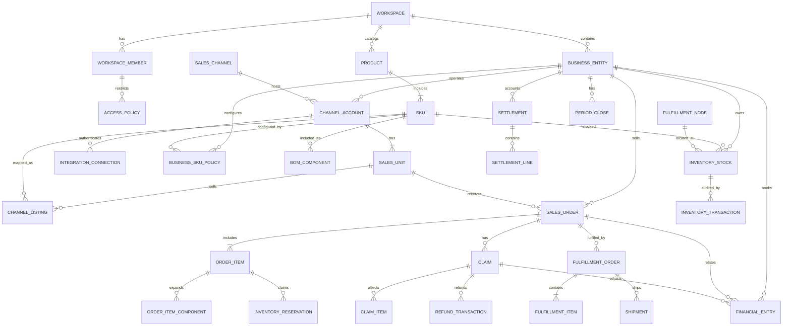

# 도메인·ERD·불변조건 명세

> 이 문서가 데이터 관계의 기준이다. `sql/001-core-schema.sql`은 일부 주요 테이블의 실행 출발점이며 전체 프로덕션 스키마를 대신하지 않는다.

## 1. 도메인 ERD(논리 관계)

## 2. 업무 객체의 식별/귀속 기준
| 객체 | 식별 키 및 범위 | 보존/규칙 |
|---|---|---|
| 운영그룹 | `workspace_id` | 다른 그룹 데이터 차단 |
| 사업자 | `business_entity_id` + workspace_id | 사업자 번호/유형·과세 구분, 계정 변경 이력 |
| 판매계정 | `channel_account_id` + 사업자 | 같은 채널 복수 계정 허용 |
| 판매단위 | `sales_unit_id` + 계정 | 외부 하위 쇼핑몰 없으면 기본 단위 생성 |
| 판매상품 | 판매단위 + 외부상품/옵션 식별자 + 유효기간 | 상품번호 변동 이력 |
| 공통 SKU | workspace + sku_code | 사업자별 소유/원가 분리 |
| 주문 | 판매단위 + 외부주문 식별자(원천별 구분 가능) | Raw 입력과 변환 버전, 귀속 Snapshot |
| 주문상품 | 내부 order_item_id / 외부 상품주문키 | 수량·할인·세금·원가 기준 고정 |
| 클레임 | 내부 claim_id + 외부 클레임 식별자 | 주문상품/수량 단위, 환불과 검수 분리 |
| 재고 | 소유자 + SKU + 거점 + 위치 + LOT + 품질/보류 | 물리·가용·판매가능 의미 차원 분리 |
| 출고 | 내부 fulfillment_order_id | 하나의 주문에서 복수 출고 가능 |
| 배송 | shipment_id + 송장 식별 | 출고와 1:N 가능; 합포장 정책 관리 |
| 정산 | 사업자 + 판매계정 + 정산차수 + 원본행 ID | 원본/매핑 버전·파일/시트/행 추적 |
| 재무 원장 | immutable entry ID + source_event | 정정은 역분개/상계 거래로 연결 |

## 3. 상품/SKU/BOM/GWP
- `product`는 고객·브랜드 관점의 그룹. 재고는 `sku` 단위. 1:N 상품:SKU; 판매단위의 외부 옵션은 내부 SKU를 참조.
- `sku_type`: NORMAL, BUNDLE(가상묶음), KIT(실물세트), MATERIAL, GIFT, SAMPLE, SERVICE, DIGITAL. `sellable`, `purchasable`, `inventory_managed`는 독립 속성.
- Product Option/Value, SKU Option Value 모델을 사용. SKU의 옵션문자열만으로 SKU를 식별하지 않음.
- BOM `SALES_BUNDLE, ASSEMBLY, PACKAGING, PROMOTION, MANUFACTURING`; DAG 순환 금지, 유효기간과 버전 관리. 주문 시 BOM 버전 Snapshot을 OrderItemComponent에 고정.
- 가상묶음 가용수량은 단일 거점 출고 전제이면 각 **허용 출고거점별** `MIN(floor(부품가용/소요수량))` 합산 범위를 검증; 교차거점 분할출고는 별도 정책 및 비용/SLA 확인.
- 실물 KIT 조립은 부품 `ASSEMBLY_OUT` 및 완제품 `ASSEMBLY_IN`; 해체는 역작업, 회수가능 수량과 상태 검사.
- `promotion/GWP`: 사업자+계정 대상/제외/기간/조건/선착순/중복그룹/품절/대체/반품정책; 주문의 증정행은 0원, `gwp_campaign_id`·발생출처·원가 Snapshot 보관.

## 4. 재고 모델
- `inventory_stock`: 물리 보유수량을 `owner_business_entity_id`, `sku_id`, `node_id`, `location_id`, `lot_id`, `quality_status`, `hold_reason` 단위로 보관.
- `inventory_transaction`: 입고, 출고, 상태변경, 예약/해제, 할당, 이동, 조립/해체, 실사조정, 불용/폐기. 변경 전후·사유·관련 주문/출고/반품·사용자/연동 주체 포함.
- `inventory_reservation`: 주문상품/구성 SKU/거점, quantity, state=`RESERVED|ALLOCATED|PICKING|CONSUMED|RELEASED`. 한 예약은 동시에 둘 이상의 활성 단계에 속하지 않음.
- `normal_on_hand`: 총 실재고에서 품질상 판매불가 및 보류를 제외한 정상/판매가능 품질의 실물 수량(중복 분류하지 않음).
- `committed`: 예약/할당/피킹에서 **중복 제외** 확보수량.
- `available_to_promise_internal = max(0, normal_on_hand - committed - safety_stock)`.
- `publishable_per_channel`: 추가 출고/재고배분/채널버퍼/채널 API 정책을 고려한 수량이며 채널에 무조건 총재고를 동기화하지 않음.
- 외부 3PL은 원본 제공값이 총재고인지 가용인지·어느 주문이 반영됐는지 명시. 반영 여부 확인 불가 시 안전하게 제한/대사.
- **불용 분류가 곧 평가손실 확정은 아니다.** 별도 `inventory_valuation_entry`와 재고장부가액/회계정책.
- 외부 3PL의 `불용` 용어가 단순 입고대기/비가용을 포함할 수도 있으므로 문자값만 보고 폐기 또는 감가 처리 금지.

## 5. 판매/출고/클레임
- `sales_order`: 원본 원천과 정규화 버전, 사업자·계정·판매단위 귀속, 주문시점 할인·결제·과세·배송 Snapshot.
- `order_item`: 원주문 수량, 취소 확정, 출고 완료, 반품 확정, 교환 대체/추가. 상품/옵션명·매출·세금·할인 부담 주체·원가 기준 Snapshot.
- `order_item_component`: 가상묶음/증정/포장부자재 실제 출고 구성을 표현. 외부 표시 주문상품과 WMS Picking SKU가 다를 수 있음.
- `fulfillment_order`: 출고거점·화주계정·출고 서비스/SLA·우선순위·외부 출고 ID·멱등키; 필요시 분할.
- `shipment`: 송장번호/택배사/포장/출고 확정/집하/배송 단계, ShipmentItem으로 주문상품/실제 구성품과 연결.
- `claim`: CANCEL/RETURN/EXCHANGE. 고객 요청/내부 결정과 실물 회수·재출고·환불은 별개 관계.
- `return_receipt/inspection`: 실수령 SKU와 주문상품 불일치 가능성을 표현, 검수결과를 부분 수량별 기록.

## 6. 정산/손익
- `settlement_line`: 원본 파일/행/정산 차수/계정/주문상품 연결 정확도, 항목(판매/배송비/수수료/할인보전/환불/패널티 등)을 표준화.
- `bank_deposit`와 `deposit_match`: 입금-정산 다대다 연결. 금액 차이·미입금/초과입금 표시.
- `financial_entry`: source event + category + amount/currency + vat/tax type + business + references + estimated/actual/adjustment + period.
- `cost_entry` 또는 재무 원장의 cost category를 단일 출처로 사용. **같은 비용을 두 테이블에서 두 번 집계하지 않도록** 명확한 권위 모델을 선택.
- `cost_allocation`: 기간 광고/보관비/공동비용을 주문/SKU/사업자에 배부할 때 방법/버전/분모·분자·미배부 잔액.
- `profit_snapshot`: 집계 캐시, 원장이 진실원. period close 후 새 조정은 이력과 새 기간 조정으로 유지.
- `sales_adjustment`: 취소/환불/교환 차액/고객보상; **정산 line과 병행 존재하더라도 원본 동일 거래의 이중 매출조정 금지**.

## 7. 독립 불변조건(테스트 대상)
1. 워크스페이스 교차 참조 및 과거 주문의 사업자 재귀속 금지.
2. 외부 주문 ID 유일성은 판매계정/판매단위 범위; 인증정보는 계정별/권한별.
3. 재고 원장의 수량 변화 합계와 Stock Bucket 수량 일치(필요시 검증센터).
4. 확보수량은 활성 예약상태 하나로만 집계; CONSUMED/RELEASED는 ATP에서 제외.
5. 원본 외부 재고 Snapshot과 내부 보완상태를 분리하고 무단 덮어쓰기 금지.
6. 주문 취소/반품/교환 수량은 원주문·실출고·실회수 한도 검증.
7. 실물 반품 검수 후에만 정상 재판매 가능. External 검수 API 미제공이면 '미확정'.
8. 재무 원장은 수정·삭제하지 않고 역분개·정정. 예상값과 실제값 중복 합산 금지.
9. 부가세 포함/제외·판매자 부담/채널 부담 할인·주문별/기간별 비용 배부를 구분.
10. 같은 작업/이벤트 재시도는 중복 환불·출고·재고변동을 만들지 않음.

## 8. SQL 관련 주의
`sql/001-core-schema.sql`은 *작동 가능한 핵심 구조 출발점*이지만 일부 확장 모듈은 문서만 정의됐다. Claude Code는 PR 단위 migration으로 상세 테이블·FK·CHECK/Unique Index를 추가해야 한다. 임의로 한 테이블에 모든 업무 속성을 합쳐 넣지 않는다.

---

## 개정 이력(2026-11-21, 위임 결정 docs/11 §H)
- CHG-001: ERD에 `CHANNEL_ACCOUNT_ATTRIBUTION`(판매계정 사업자 귀속 이력), `SHIPPER_ACCOUNT`, `LOGISTICS_PROVIDER`, `ROLE`/`MEMBER_ROLE`/`MEMBER_SCOPE`, 운영 엔터티(`AUDIT_LOG`, `OUTBOX_EVENT`, `ASYNC_JOB`, `STORED_FILE`, `WORK_ITEM`, `INTEGRATION_CREDENTIAL`, `CONNECTION_CAPABILITY`)를 추가한다. 실제 정의는 `migrations/V1~V4`.
- CHG-011: 포장 부자재 비용 출처는 거점·3PL 계약별로 (a) 자체 포장 BOM 원가 (b) 3PL 포장비 포함 (c) 3PL 별도 청구 중 하나만 적용한다.
- DLG-004: 비용·매출 권위 원장은 단일 `financial_entry`(basis=ESTIMATED/ACTUAL).
