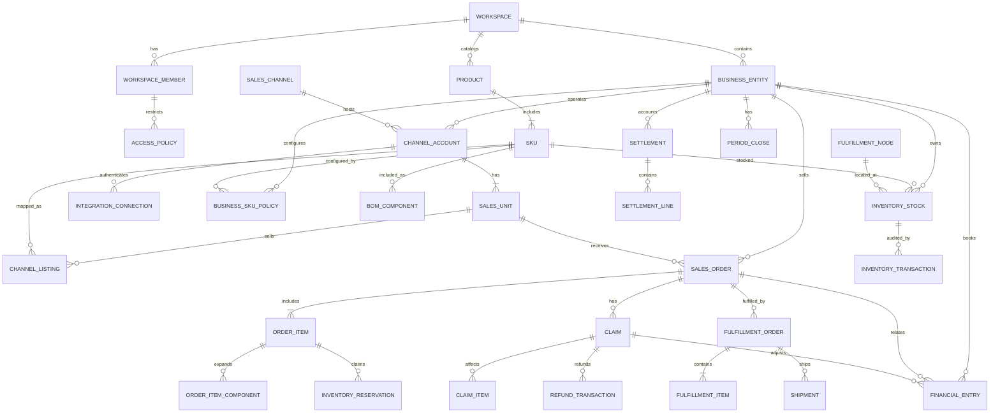

# 커머스 통합 운영관리 플랫폼 — 전체 인수인계본 (개발용)

> 이 파일은 탐색용 합본입니다. 수정의 기준은 개별 docs/ 파일 및 CLAUDE.md이며, 파일 간 충돌은 docs/11의 결정사항으로 관리합니다.

## 수록 문서

- `docs/00-PRD.md`
- `docs/01-IA-and-UX.md`
- `docs/02-architecture.md`
- `docs/03-domain-and-ERD.md`
- `docs/04-workflows-states.md`
- `docs/05-finance-rules.md`
- `docs/06-channel-3pl-integrations.md`
- `docs/07-api-contract.md`
- `docs/08-security-and-operations.md`
- `docs/09-acceptance-tests.md`
- `docs/10-implementation-plan.md`
- `docs/11-decisions-and-open-questions.md`
- `docs/12-glossary.md`
- `docs/13-ui-fields-and-validation.md`
- `docs/14-analytics-insights.md`
- `docs/15-vat-reporting.md`
- `docs/16-release-and-operations-runbook.md`

---


---

<!-- SOURCE: docs/00-PRD.md -->


# PRD — 커머스 통합 운영관리 플랫폼

**버전:** 2.2 · **기준일:** 2026-11-21 · **상태:** 구현 기준 초안(외부 API·회계 정책 일부 확인 필요)

## 1. 비전과 포지셔닝
국내 판매자가 **여러 사업자와 판매채널 계정**을 운영하는 상황에서 상품·주문·CS·재고·물류·발주·정산·비용·손익을 연결하는 **커머스 운영 OS**.

단순 OMS 대체가 아니라 `상품 → 채널 계정별 판매 → 주문 → BOM/GWP → 재고 확보 → 출고거점 → WMS/3PL → 배송 → 취소·교환·반품 → 정산/입금 → 원가·비용 → 사업자·상품·채널별 공헌이익 → 개선 제안`의 전체 흐름을 관리한다.

핵심 질문: **무엇을 어디에서 팔았고, 무엇이 출고됐으며, 실제로 얼마가 남았고, 다음에 무엇을 바꿔야 하는가?**

### 비교 대상으로 검토한 서비스
사방넷, 플레이오토, 이지어드민/이지WMS, 셀메이트, 셀러통, 품고, 파스토 등. 벤치마크 참고용이며 경쟁서비스의 미검증 기능을 요구사항으로 전제하지 않는다.

## 2. 해결할 문제
1. 사업자·스토어별 상품/SKU·주문·정산 정보가 서로 분절됨.
2. 서로 다른 3PL의 재고 상태·수량 의미가 달라 통합재고가 부정확해짐.
3. 부분취소/반품/교환/GWP/묶음에서 주문·실물·매출·원가가 불일치.
4. 매출이 커도 채널수수료, 광고, 3PL, 부자재, 반품, 재고손실까지 반영한 실제 공헌이익을 모름.
5. 외부 API 권한/버전/호출 제한/인증 만료로 운영 중단 발생.
6. 정상 업무보다 예외처리에 사람이 많이 투입됨.

## 3. 고객 및 역할
- 운영그룹 관리자/대표: 여러 사업자 합산 성과, 승인, 통합 리스크.
- 브랜드·MD: 공통 상품/옵션/SKU/가격/GWP/채널 노출.
- 주문 담당: 주문수집, 미매핑, 보류, 분할출고.
- CS 담당: 문의·취소·반품·교환·환불/보상.
- 창고/물류 담당: 거점·재고·피킹·패킹·반품 검수·불용·폐기.
- 재무/정산 담당: 매출·정산·입금 대사, 세금 자료, 손익.
- 분석 담당: 채널·상품별 성과, 재고 회전, 비용 추세.
- 구축/연동 관리자: API 계정 연결, 오류·재처리·변환 규칙.

## 4. 성공 기준(초기 가설; 목표값은 실제 파일럿에서 합의)
- 주문 중복 생성 0건(멱등성 및 검증 시나리오 내).
- 재고 동시예약 초과판매 0건(동시성 테스트 범위 내).
- 주문·재고·정산·손익 수치에 원본 또는 원장까지 추적 가능.
- 사용자별 사업자 접근정책이 검색/API/내보내기에 동일하게 적용.
- 연동이 지원하지 않는 액션을 UI에서 숨기거나 수동처리로 안내.
- 정확한 상품/SKU/거점/사업자 귀속을 가진 반품·교환 비용.
- 운영자가 실패건을 업무함에서 원인과 권장조치로 처리.

## 5. 범위와 기능 요구사항

### FR-ORG 조직·계정·권한 — P0
- FR-ORG-01 운영그룹 1:N 사업자. 사업자마다 법인/개인, 사업자번호, 과세유형, 기본 정산계좌, 활성상태.
- FR-ORG-02 사업자 1:N 판매계정. 동일 채널에 복수 사업자/복수 계정 가능.
- FR-ORG-03 계정 1:N 판매단위(shop_no 등). 없는 채널에는 내부 기본 판매단위 1개.
- FR-ORG-04 API 인증·토큰·화주계정은 별도 객체와 권한/만료/이력.
- FR-ORG-05 같은 운영그룹 사용자 **기본 주문 조회 허용**. 사용자별 사업자/판매계정/메뉴/수정/다운로드 제한 가능. 다른 그룹 접근 불가.
- FR-ORG-06 개인정보·원가·정산·손익·환불/폐기 승인 별도 권한.
- FR-ORG-07 계정 귀속변경에 유효기간 및 과거 주문 귀속 유지.

### FR-CAT 상품·SKU·판매채널 — P0
- FR-CAT-01 공통 Product > Option/Option Value > SKU. SKU는 실물 및 원가/재고 기준.
- FR-CAT-02 SKU 유형 NORMAL/BUNDLE/KIT/MATERIAL/GIFT/SAMPLE/SERVICE/DIGITAL, 판매가능·구매가능·재고관리 여부 별도.
- FR-CAT-03 상품마스터·SKU별 다중 채널상품 매핑; 외부 SKU/상품ID 이력/매핑 신뢰도/미매핑 업무함.
- FR-CAT-04 채널별/계정별 가격·판매상태·최저판매가 보호·수수료·재고 버퍼.
- FR-CAT-05 BOM 유형 판매묶음/조립/포장/프로모션/제조. 가상묶음의 판매가능수량은 부품 가용수량과 허용 거점 조합으로 계산; 순환 BOM 금지.
- FR-CAT-06 실물 KIT 조립/해체는 재고 원장 사용. 포장 부자재는 판매제품과 분리해 물류비/원가 반영.
- FR-CAT-07 GWP 조건(기간, 채널, 사업자, 금액, 수량, SKU/브랜드, 고객조건), 재고/대체/중복/반품 정책. 채널측 사은품과 중복 지급 금지 기본.
- FR-CAT-08 LOT·유통기한·바코드/GTIN/브랜드 속성·상품 품질 점검.

### FR-ORD 주문·배송 — P0
- FR-ORD-01 외부 Raw 주문 저장 및 표준 주문 변환; `판매계정+판매단위+외부주문키`로 중복 방지.
- FR-ORD-02 주문/결제/출고/배송/클레임 상태 분리; 주문상품/수량 단위 부분처리.
- FR-ORD-03 수집→상품매핑→검증→GWP→BOM→재고예약→거점 배정→출고요청→송장 수신→채널 전송.
- FR-ORD-04 보류(재고/주소/고객/결제/GWP/3PL), 수동·B2B·샘플 주문, 대량 처리.
- FR-ORD-05 분할출고, 다중 Shipment, 배송마감/SLA/약속일, 채널별 배송정책 준수.

### FR-INV 재고·WMS·3PL — P0(고급 WMS P1)
- FR-INV-01 재고 소유사업자와 판매사업자 구분; 거점/창고/로케이션/LOT/품질상태/수량/재고원본 저장.
- FR-INV-02 예약→할당→피킹은 배타적 단계; 추가 판매가능재고 중복 차감 금지, 원자적 확보.
- FR-INV-03 실재고, 정상, 비가용, 불용, 안전, 이동중, 입고예정, 예약, 가용의 의미 명확화.
- FR-INV-04 외부 3PL 수량정의/예약 반영시점·원본상태/상태 변환/동기화 워터마크 추적, 불명확시 안전한 제한과 예외 처리.
- FR-INV-05 재고원장, 실사·조정(승인), 이동, 반품검수, 재포장, 불량, 파손, 만료, 폐기.
- FR-INV-06 Provider→Center→Fulfillment Node와 판매사업자/재고소유자/화주계정/계약관계.
- FR-INV-07 룰 기반 출고 배정: 재고소유/채널허용/지역/마감/SLA/원가/우선순위. 지원불가 거점으로 자동 전환 금지.
- FR-INV-08 자체 WMS 입고·적치·로케이션·피킹/검수·패킹·라벨·출고·반품·실사. 외부 3PL은 지원 기능만 실행.
- FR-INV-09 API/Webhook/SFTP/CSV/Excel/수동 기반 3PL 연동 및 물류비 계약요율/예상·실제 대사.

### FR-CS 문의·클레임 — P0
- FR-CS-01 채널별 문의 통합, 상태·답변기한·담당자·템플릿·응대 이력.
- FR-CS-02 취소/교환/반품은 주문·CS·물류·재무가 동일 Claim/Claim Item을 조회.
- FR-CS-03 요청/승인/회수/검수/환불/재출고 단계 독립; 원주문 없는 반품 등 예외.
- FR-CS-04 환불액, 수수료 환급, 역물류비, GWP 회수, 불용·폐기 비용을 정확히 귀속.
- FR-CS-05 AI 답변은 초안 제안부터; 자동 고객전송은 권한/검증 전 금지.

### FR-FIN 매입·정산·비용·손익 — P1(자료모델 P0)
- FR-FIN-01 사업자별 공급처/공급처 SKU/발주/MOQ/리드타임/부분입고/실매입/부대원가 배부.
- FR-FIN-02 주문매출·순매출·매출인식액·정산예정·정산확정·입금액·공헌이익 구분.
- FR-FIN-03 채널별 정산 원본 보관/변환/주문상품·그룹 대사·입금 다대다 매칭.
- FR-FIN-04 판매수수료·PG·광고·배송/3PL·포장재·GWP·반품/교환·재고손실·기타 비용 원장.
- FR-FIN-05 예상 비용/실제 비용 중복 차감 금지; 원가 Snapshots/버전/귀속기간.
- FR-FIN-06 취소·반품·교환이 환불·매출조정·원가환입·재고평가·역물류비를 자동 연결.
- FR-FIN-07 사업자·판매계정·채널·상품·SKU·GWP·클레임·거점별 손익 Drill-down.
- FR-FIN-08 사업자별 월 마감/마감 후 조정; 부가세 신고자료 입력/파일정규화/내보내기(자동 세무신고 아님).

### FR-OPS 업무함·분석·인사이트 — P0 핵심/P2 고도화
- FR-OPS-01 정상 자동처리, 예외만 업무함(원인/영향/해결 실행/담당/긴급도/마감/재알림).
- FR-OPS-02 연동 오류 통합/반복 오류 묶음/재처리/이력/인증만료 경고.
- FR-OPS-03 운영 데이터 검증: 중복 주문, 3PL 불일치, 환불·원가·비용 누락·중복, 사업자 귀속 오류.
- FR-OPS-04 상품정보 품질, 품절예측, 재고이동/발주 제안, 물류비·프로모션 수익성 시뮬레이션.
- FR-OPS-05 인사이트: 이상 발견→원인→제안→영향 시뮬레이션→사람 승인; AI 임의 실행 금지.

## 6. 판매채널 범위
### 우선 개발
카페24, 네이버 스마트스토어, 쿠팡 마켓플레이스, 쿠팡 로켓그로스, G마켓, 옥션, 11번가. 쿠팡 직매입은 별도 B2B 도메인.

### 확장
카카오톡스토어, 카카오 선물하기, 토스쇼핑, 롯데ON, SSG.COM, 무신사, 에이블리, 지그재그, 29CM, W컨셉, 오늘의집, 퀸잇, 컬리, 올리브영, 알리익스프레스, Temu 등. **입점/제휴 및 계정별 인증 권한 확보가 선행조건**.

## 7. UI 및 경험 원칙
- 전체 사업자 / 선택 사업자 필터가 헤더와 목록·보고서 전체에서 일관되게 동작.
- 공통 목록: KPI → 검색/필터 → 저장된 보기 → 테이블 → 일괄 처리. Drawer로 빠른 상세.
- 모든 행에는 사업자/채널/판매계정 식별 문맥 표시.
- 정상 데이터보다 예외와 마감 임박 항목 우선, 위험 액션은 사전검증·영향도 표시.
- 모바일 1차: 홈, 업무함, 주문/재고조회, WMS 스캔, 출고/입고, 알림.
- 접근권한, 개인정보 표시, 내보내기는 사용자별 정책에 따라 통제.

## 8. 비기능 요구사항
- 정확성: 재고 원자적 확보, 원장 append-only, 정산 중복/누락 검증.
- 안정성: 외부 API 비동기, 재시도, 멱등성, 타임아웃/사후 확인, 계정 장애 격리.
- 보안: 운영그룹 테넌트 분리, 서버 RBAC+사용자 범위, 개인정보 최소수집/마스킹, 비밀관리.
- 추적성: 외부 원본·파서버전·기준시각/워터마크·감사로그·손익 근거.
- 성능: 핵심 목록 페이지네이션/인덱스, 집계 캐시/스냅샷, 대량 처리 비동기.
- 가용성 목표/SLA·보관기간·RPO/RTO는 고객/운영환경 확인 후 확정; 임의 수치 약속 금지.
- 국내 용어 기준은 `docs/12-glossary.md`.

## 9. 범위 제외 및 가정
- 1차에 모든 채널/물류사 100% API 기능 구현을 약속하지 않는다.
- 법적 세무 신고 자동 제출, ERP 총계정원장 대체, 연결재무제표, 은행 자동 연동은 초기 범위 밖.
- AI의 승인 없는 대량 환불·재고이동·가격 변경은 범위 밖.
- 자동화 가능 기능은 판매계정의 실제 권한/약관/지원 API를 확인해야 한다.

## 10. 출시 게이트
1. `docs/09-acceptance-tests.md`의 P0 시나리오 통과.
2. 정산·비용을 제공하는 출시에서는 동일 문서의 재무 테스트까지 통과.
3. 권한 우회(직접 URL/API/파일) 차단 검증.
4. 3PL 및 판매계정별 장애/동기화 재처리 리허설.
5. 모든 데이터 값의 사업자 귀속과 원본 추적 가능.


---

<!-- SOURCE: docs/01-IA-and-UX.md -->


# IA·화면 명세 — 국내 운영자용 UI

> 공통 UI는 한국어. 모든 목록의 기본 식별 문맥은 `사업자 / 판매채널 / 판매계정 / 판매단위`이며, 해당 없는 객체는 적절히 생략한다. 컬럼은 사용자별 저장 가능.

## 1. 전체 메뉴

```
홈
업무함 [내 업무, 팀 업무, 전체 업무, 데이터 검증]
상품 [상품마스터, SKU, 묶음·세트, GWP·증정, 채널상품, 상품 연결·매핑, 가격·판매정책, 품질 점검, 일괄 작업]
주문 [전체 주문, 배송관리, 주문 보류, 취소, 교환, 반품, 수동·B2B 주문, 수집·처리 오류]
CS [CS 통합함, 문의, 배송문제, 상담이력, 답변 템플릿, 처리 기준, 현황]
재고 [통합재고, 거점별 재고, 재고원장, 예약·할당, 재고이동, 재고조정·실사, LOT·유통기한, 비가용·불용재고, 채널 재고배분, 재고정책]
물류·3PL [운영현황, 출고관리, 입고관리, 반품물류, WMS 작업, 출고 배정정책, 물류사업자, 물류센터·거점, 3PL 연동, 물류비, SLA]
발주·매입 [현황, 공급처, 발주, 발주 제안, 입고예정, 매입, 매입원가, 차이]
정산 [현황, 예정, 확정, 채널별, 대사, 조정, 입금 대사, 월 마감, 부가세 신고자료]
비용·원가 [비용 현황, 상품원가, 판매·결제수수료, 배송·물류비, 광고비, 부자재, GWP, 클레임비용, 재고손실]
손익 [현황, 주문별, 상품별, SKU별, 묶음별, 채널별, 판매계정별, 브랜드별, 사업자별, GWP 성과, 클레임 손익, 대사]
분석 [매출, 재고, 클레임, 배송/SLA, 광고, 상품/채널 비교]
인사이트 [오늘의 인사이트, 이익 개선, 재고 최적화, 물류 최적화, 상품 분석, 시뮬레이션]
연동 관리 [판매채널, 물류·3PL, 택배, 광고, ERP·회계, 파일 연동, 지원 기능, 연동 진단, 오류, 이력]
설정 [운영그룹, 사업자 관리, 사용자·권한, 브랜드, 판매계정, 정산계좌, 승인정책, 알림정책, 원가·마감정책, 변경이력]
```

**메뉴 노출:** 사용자 권한/사용 계약/설정에 따라 표시; 미출시 기능은 보이지 않거나 비활성화하며 이용 가능한 기능인 것처럼 표시하지 않는다. 클레임은 주문·CS·물류가 동일 객체를 다른 보기로 공유한다.

## 2. 전역 레이아웃
- 헤더: 운영그룹 / **전체 사업자 또는 사업자 선택** / 브랜드 / 통합검색 / 빠른 작업 / 연동 상태 / 알림 / 사용자.
- 통합검색: 내부/외부 주문번호, 송장, 상품, SKU/바코드/GTIN, 판매계정, 고객(권한 범위), 입출고·반품·정산 번호. 검색결과에 반드시 사업자/계정 표시.
- 공통 리스트: 제목/핵심 실행 → KPI → 검색/기본 필터/상세필터 → 저장 보기 → 테이블 → 일괄 작업.
- 행 선택/상세: 행 클릭 우측 Drawer, 제목 링크 전체 상세, 체크박스 일괄 작업. Drawer에서 관련 객체 이동.
- 모든 작업: 권한/가능상태에 따라 액션 활성화, 사전 영향도 미리보기, 비동기 작업 진행률/결과보고.
- 빈 목록: 원인·다음 액션. 장애: 마지막 정상 시각, 재시도. 외부 데이터 오래됨: 기준시각/경고.
- 기본 상태: 정상/대기/진행중/보류/확인필요/오류/완료/중지 — 색상만 사용하지 않음.
- 관리 화면: 키보드 검색 `/`, Esc 닫기, 사용자별 칼럼/보기 저장. 반응형 우선순위는 조회·업무함·현장 작업.

## 3. 화면별 실행 명세

### 홈
- KPI: 오늘 주문, 결제금액, 출고대기, 출고마감 위험, 재고위험, 처리 필요.
- 주요: 오늘 처리할 일, 주문 처리 파이프라인, 거점별 현황, 품절위험, 데이터 검증 이상, 연동장애.
- 필터: 사업자/브랜드/판매계정/기간; 역할별 기본 구성. KPI 카드 클릭 → 필터가 적용된 실제 목록.

### 업무함
- 기본 보기: 내 업무/팀/전체/긴급/오늘 마감/데이터 검증/연동 오류.
- 컬럼: 사업자·계정, 업무유형, 제목, 영향(건수/금액), 우선순위, 담당자, 마감, 상태, 최초/마지막발생.
- Drawer: 문제·원인·관련 객체·원본 오류 요약·권장조치·실행버튼·재시도·다시 알림·활동이력.
- 상태: 대기/진행/보류/완료/무시; 같은 근본 오류는 하나의 Incident로 묶고 영향건수 증가. SLA 초과는 Snooze 중에도 표시.
- 권한: 다른 사업자의 업무는 기본 조회 허용, 수정은 역할별. 원가·PII 정보는 별도 허가.

### 상품 > 상품마스터
- KPI: 전체/판매중/판매중지/품절위험/확인필요.
- 검색: 상품명, 내부명, 상품ID, SKU, 바코드/GTIN, 외부 상품번호.
- 필터: 사업자(사업자별 운영상태 확인용), 브랜드, 카테고리, 유형, 판매상태, 채널, 재고위험, 마진 구간.
- 컬럼: 이미지, 상품명/내부명, 브랜드, 유형, SKU수, 판매계정 수, 총 판매가능, 판매상태, 30일 판매/순매출, 공헌이익률, 품절예상, 이슈.
- 액션: 상품등록/엑셀등록/채널가져오기/복제/편집/보관; 일괄 상태, 브랜드/카테고리, 채널 발행, 정책 변경.
- 상세 탭: 개요, SKU, 채널상품, 재고, BOM, GWP, 가격, 원가(권한), 물류, 매출·손익(권한), 이력.

### 상품 > SKU
- 컬럼: SKU 코드, 상품/옵션, 바코드/GTIN, 유형, 소유사업자(재고 뷰), 실재고/비가용/예약/할당/피킹/가용, 입고예정, 연결채널, 원가(권한), 기준가, 재고일수, 상태.
- Drawer: 거점·소유사업자별 수량, 채널상품, 구성된 묶음, GWP, 최근 재고원장.
- 액션: SKU 추가/수정, 정책/LOT, 사업자별 활성·원가, 바코드 연결. 실제 재고수정은 조정원장을 통해서만.
- 검증: SKU코드 유일성(워크스페이스 범위), 바코드 중복 경고, 유효한 단위·중량, 매출이력 SKU 삭제 불가.

### 상품 > 묶음·세트
- 탭: 전체/가상 묶음/실물 세트(동적 구성은 후속).
- 컬럼: 묶음SKU, 유형, 구성품수, 허용거점 기준 판매가능, 실물세트 재고, 추가조립 가능, 구성원가/포장비, 판매가/예상 이익.
- 편집: 한 페이지 BOM 구성(부품 SKU·수량·필수·버전·적용일), 포장프로필, 원가/물류비 미리보기.
- 액션: 가상묶음 등록, 세트 조립·해체, 버전 발행. 순환 BOM/자기참조/0 수량/미지원 3PL Kitting 금지.

### 상품 > GWP·증정
- KPI/탭: 진행중/예정/재고위험/중지/종료; 컬럼 캠페인·사업자/계정·기간·조건·증정SKU·재고·지급수·중복정책.
- 편집: 대상/제외 조건, 주문금액·SKU·기간·고객조건, 증정 우선순위/대체, 소진 정책, 중복 정책, 반품 시 회수.
- 명세: 외부 채널이 이미 지급한 사은품은 출처 표시, 기본적으로 중복지급 금지. 주문상품 0원과 상품 원가는 별도.

### 상품 > 채널상품 및 연결·매핑
- 컬럼: 사업자, 채널·계정·판매단위, 외부상품/옵션키, 내부 상품/SKU, 채널가/채널재고, 판매상태, 최근동기화, 연결상태.
- 기본 탭: 확인필요/미연결/충돌/전체. 제안 SKU·근거(바코드/GTIN/이름)·수락/다른 SKU/신규생성.
- 주의: 동일 외부번호의 계정 혼동 금지, 과거 매핑 보존, 채널별 상품 필수 속성 검증.

### 주문 > 전체 주문
- KPI: 오늘/처리중/출고대기/배송중/클레임/오류.
- 검색: 내부·외부 주문, 상품/SKU, 송장, 고객(권한). 필터: 사업자·계정·주문기간·결제·주문·출고·배송·클레임·거점·GWP·묶음·부분처리·지연.
- 컬럼: 주문일시, 사업자, 판매채널·계정, 내부/외부번호, 상품·수량, 결제액, 결제/출고/배송/클레임 상태, 거점, 이슈·담당자.
- Drawer: 주문/상품/BOM/GWP/출고·송장/고객/환불 요약, 관련 객체 링크, 상태에 따른 보류·주소수정·출고 변경·취소·클레임 생성.
- 전체 상세 탭: 주문정보/상품/배송·출고/CS/클레임/결제·환불/정산/손익/이력.
- 일괄: 확정, 출고지시, 거점변경, 보류/해제, 담당, 메모, 내보내기. 실행 전 가능/불가 건수 표시.

### 주문 > 배송관리·보류·취소·반품·교환
- 배송관리 기준 객체는 Fulfillment Order/Shipment. 컬럼 출고번호·주문번호·거점·물류사·상품·수량·마감·상태·운송장·SLA.
- 보류: 사유(재고/주소/고객/결제/GWP/물류/관리자), 보류자·발생시각·해제조건.
- 취소: 클레임번호·주문상품·요청수량·취소금액·출고중지 가능·승인상태.
- 반품: 고객 회수·환불과 물류 검수를 분리. 검수 Drawer는 수량별 정상/재포장/불량/파손/반송/폐기, 사진·LOT·GWP 회수.
- 교환: '회수'와 '새 출고' 두 패널, 차액결제/환불, 선출고 승인정책.

### 재고 > 통합재고·거점별·재고원장
- KPI: 총 SKU/재고자산/품절/품절위험/비가용/불용/장기재고.
- 컬럼: 소유사업자, SKU/상품, 거점, 총 실재고, 정상, 예약/할당/피킹(배타), 보류, 비가용/불용, 안전, 추가 판매가능, 입고예정/이동중, 판매/재고일수.
- Drawer: 사업자·거점·LOT·품질상태 수량과 외부 기준시각/수량정의; 원장 최근 5건; 관련 출고/반품.
- 원장: 발생시각/SKU/사업자/거점/유형/상태이동/변동수량/이전·이후/원인/참조/처리자. 직접 편집 금지.

### 재고 > 비가용·불용 / 이동 / 실사 / 채널배분
- 비가용·불용 탭: 검수/재포장/보류/불량/파손/만료/폐기대기/전체. 컬럼 LOT, 원가, 추정손실, 경과, 원인, 관련 반품.
- 조정: 현재수량/실사수량/차이/사유/승인자/첨부. 실사 기본 Blind Count. 사업자·거점별 차이 승인.
- 이동: 출발·도착 거점, 동일 재고 소유자, 수량, 이동중 재고. 소유자 변경은 별도 사업자 간 거래.
- 채널배분: 계정별 비율/최대/고정/버퍼/재고 공유 범위, **실행 전 판매수량 시뮬레이션**.

### 물류·3PL > 운영현황·출고·입고·WMS
- 거점별 오늘출고/대기/지연/재고 이슈/연동 오류.
- 출고관리: 출고번호·사업자·계정·거점·화주계정·상품·수량·우선순위·마감·상태·운송장·오류. 액션 출고요청/취소/보류/변경/재전송/송장등록.
- 입고: 입고예정/센터도착/검수/적치/완료/차이, 수량 정상·불량·미입고. 사업자별 공급처·발주 참조.
- 자체 WMS: 입고·적치·로케이션·Wave·피킹·스캔검수·패킹·부자재·운송장·출고·반품·실사.
- WMS 모바일: 로케이션/SKU 바코드, 피킹 필요/완료 수량, 잘못 스캔 시 차단.
- 거점 설정: 사업자/화주/온도대/지역/배송 프로그램/SLA/마감/재고원본/지원 기능.
- 출고 배정: 규칙 우선순위/예외/시뮬레이션; 미지원 배송프로그램으로 임의 대체 금지.
- 물류비: 계약요율/예상/실제 청구/대사, 택배/피킹/패킹/보관/반품/재포장/조립/부자재.

### CS > 통합함·문의·처리 기준
- KPI: 미답변/오늘마감/처리중/고객 재응답/클레임 연계/배송문제.
- 컬럼: 사업자·계정, 고객(마스킹), 주문/상품, 문의 유형, 제목/최근 응답, 담당자, 상태, 응답기한.
- Drawer: 메시지 Thread, 주문·출고·클레임·환불 요약, 가능한 작업(주소변경 시도/출고중지/답변/클레임).
- 응대 템플릿 변수 고객명/주문번호/상품/송장. 고객 통합식별은 채널 약관 및 개인정보 정책 준수.

### 발주·매입
- 공급처 목록: 사업자, 업체명, 리드타임, MOQ/발주단위, 결제조건, 공급SKU 수, 상태.
- 발주 목록: 발주번호, 사업자, 공급처, 거점, 예정일, SKU수/수량, 금액(공급가/세금), 상태/입고진척.
- 발주 상세: 승인/발송/부분입고/불량/차액/부대원가. 제안은 최근 판매·확정 입고·프로모션 수요·리드타임 고려.

### 정산·비용·손익
- 상단 공통 필터: 사업자/채널/판매계정/판매단위/기간/확정상태.
- 정산: 예정/완료/대사/조정/입금/월마감/신고자료, 실제 원본파일/시트/행 추적.
- 비용: 유형·발생원천·관련 주문/SKU/거점·예상/확정·귀속/원가 포함 여부.
- 손익: 주문/SKU/상품/브랜드/채널/계정/사업자/GWP/클레임, 금액 클릭 → 원장·원본까지 Drill-down.
- 확정도를 임의 백분율로 표현하지 말고 '확정된 비용'과 '미확정 항목' 목록을 표시.

### 연동 관리
- 판매채널/물류/택배/광고/회계/파일. 계정별 인증/유효기간/권한/지원기능/버전/호출제한/최종동기화/오류/재처리.
- 상태값은 정상/지연/오류/인증만료/일시중지; 파일 연동 시 양식 인식→컬럼 매핑→미리보기→실행→결과.
- 3PL 상태 변환표: 원본 상태→내부 가용상태→품질상태/미확정; 외부 원본은 절대 덮어쓰지 않음.

### 인사이트
- 오늘의 인사이트/이익개선/재고최적화/물류최적화/상품분석/시뮬레이션.
- 제안 카드: 관측기간·근거 데이터·예상효과·가정/불확실성·[상세분석][시뮬레이션][실행 승인 요청].
- AI 제안은 초기 읽기·추천 전용. 인사이트 미출시 시 메뉴 비노출.

## 4. 화면 공통 상태 및 검증
- 모든 목록: Empty/Loading/Error/권한없음/데이터지연/동기화중/부분처리.
- 금액·재고·사업자 변경 위험 작업: 영향도 미리보기, 권한/승인 확인, Undo 가능 여부 안내, 감사로그.
- 대량 파일: 구문검사·필드 매핑·오류/경고/정상 건수 Preview, 문제행 내보내기, 실제 실행 전 승인.
- 로그/오류 원문은 기술 뷰에만, 운영 화면은 사람이 처리할 수 있는 이유·대안을 우선 노출.


---

<!-- SOURCE: docs/02-architecture.md -->


# 기술 구조 및 설계 결정

## 1. 권장 초기 기술 스택 (확정 전 기본안)
- **Backend**: Java 21 LTS + 구현 시점에 지원되는 Spring Boot 릴리스, Spring Security, Spring Data/JPA + 중요한 원장/잠금 SQL은 명시적으로 관리.
- **Frontend**: React + TypeScript + 지원 중인 Next.js 릴리스; 한국어 관리자 UI, 모바일/PDA 분리 뷰.
- **DB**: PostgreSQL (OLTP/원장), 스키마 버전 마이그레이션(Flyway 등).
- **Cache/운영**: Redis 선택 사용(세션/캐시/호출제한). **재고 원장이나 결제 이벤트의 단일 진실원으로 사용하지 않음**.
- **비동기 작업**: DB 트랜잭션 Outbox + 작업자; 규모와 운영 요구에 따라 큐 브로커(RabbitMQ 등) 도입 검토.
- **파일**: 객체 저장소(S3 호환), 파일 바이러스 검사, 접근 제어, 원본 해시 보관.
- **Test**: JUnit 5, Testcontainers(PostgreSQL), API 통합, 계약 테스트, Playwright UI E2E.
- **Infra**: dev Docker Compose, 운영 환경은 컨테이너 배포 + 모니터링·시크릿 관리.

**이유:** 제품 담당 조직의 Java/Spring 경험과 주문·재고·금액의 트랜잭션 일관성을 고려. 프론트/API 분리는 유지하되 초기부터 마이크로서비스를 만들지 않는다. 버전은 개발 시작 시 최신 LTS·지원정책 확인 후 ADR로 고정한다.

## 2. 모듈형 모놀리스(논리 경계)
```
Identity & Access       운영그룹/사업자/사용자/정책
Catalog & Pricing       상품/옵션/SKU/BOM/가격/GWP
Channel Integration     판매계정/채널상품/Raw 주문/변환
Orders                  주문/주문상품/금액 스냅샷
Claims & CS             문의/취소/교환/반품/환불
Inventory               재고 소유권/LOT/원장/예약/실사/평가
Fulfillment & WMS       출고 배정/출고/송장/창고작업
Logistics Integration   3PL/화주/원본 재고/파일/요율
Procurement             공급처/발주/입고/매입원가
Finance                 매출조정/정산/입금/비용/마감
Profit & Analytics      손익/배부/집계/인사이트
Operations              업무함/검증/알림/감사/승인
```
모듈은 공개된 서비스/도메인 이벤트로 협력한다. 다른 모듈 테이블을 임의 UPDATE하지 않는다.

## 3. 이벤트·작업 처리
- 거래 데이터와 outbox 메시지를 같은 DB 트랜잭션에 쓰고 커밋 후 전송.
- 작업자 전달은 at-least-once를 전제로 멱등 처리. 외부 출고·환불 등은 **사전 조회/거래키 확인** 후 재시도.
- 큐/작업: `PENDING → RUNNING → SUCCEEDED|RETRY_WAIT|REVIEW_REQUIRED|FAILED`.
- 외부 리턴 지연/중복/역순을 허용. 표준 상태로 변환 시 전이 검증 + 이상 이벤트 보존.
- 계정별 Rate Limit/토큰/백오프/차단기(circuit breaker). 특정 계정 장애를 다른 계정으로 전파하지 않음.
- API 원문/응답/파일/연동 규칙 버전/커서/동기화 워터마크 보존.

## 4. 다중 사업자·보안 아키텍처
- `workspace_id`로 조직 간 논리·API 격리. 모든 핵심 조회/업데이트 서버에서 스코프 확인.
- 기본값은 워크스페이스 구성원 모두의 운영 주문 조회 가능; 명시 제한 적용 시 해당 사업자/판매계정 전체 API와 데이터 내보내기에서 제외.
- PII/원가/정산/손익/승인·일괄작업은 별도 권한. 사용자 역할 + 명시 Deny + 행 수준 범위.
- DB 계층에 FK/유일성/체크 제약. 중요 테이블은 서비스 스코프 강제와 필요 시 PostgreSQL RLS를 **방어적 보조수단**으로 검토.
- 물류사 화주계정과 재고 소유자 및 판매자 다를 수 있음; 기본 배정은 동일 소유자만.
- 과거 주문의 사업자/판매계정 귀속은 당시 Snapshot 고정.

## 5. 정합성 아키텍처
- 재고: append-only transaction + canonical stock bucket + 단일 reservation lifecycle. 상태전이는 같은 트랜잭션.
- 3PL: 외부 quantity semantic(총재고/가용/출고후예상/품질)과 반영 워터마크를 알고 내부 미반영 확정예약만 차감.
- 회계: 운영 매출 이벤트/환불/원가·비용·재고평가 원장 각각 별도; 손익은 유효한 금액 항목 합산.
- 스냅샷은 조회/기간 마감 최적화, 원본 원장을 대체하지 않음. 재계산 가능성을 보장.
- 계정별 API 지원 기능을 런타임 Capability로 관리; UI에서 가능한 액션만 활성화.

## 6. 읽기 모델/성능
- 원장과 원본은 정확성과 감사 우선. 목록/대시보드/손익 집계는 읽기 모델 또는 집계 테이블.
- 큰 테이블은 `workspace_id, business_entity_id, sales_unit_id, created_at, status` 중심 인덱스.
- 목록은 커서 페이지네이션, 백그라운드 Export. 원본/PII 다운로드는 감사 추적.
- 정산/손익 집계에 지연 시각과 최종 확정일을 표시.

## 7. 비기능 확인 필요
- 고객사별 트랜잭션량/최대 SKU/판매계정 수, P95 SLA, 백업 RPO/RTO, 데이터 보관기간, API Rate Limit 실제 수치, 웹훅 제공범위는 아직 확정되지 않음.
- 로그에 전화번호, 상세주소, API 토큰, 카드정보 등 원문을 남기지 않도록 구조화/마스킹. 저장된 Raw 주문도 암호화·보관 정책 수립.


---

<!-- SOURCE: docs/03-domain-and-ERD.md -->


# 도메인·ERD·불변조건 명세

> 이 문서가 데이터 관계의 기준이다. `sql/001-core-schema.sql`은 일부 주요 테이블의 실행 출발점이며 전체 프로덕션 스키마를 대신하지 않는다.

## 1. 도메인 ERD(논리 관계)


## 2. 업무 객체의 식별/귀속 기준
| 객체 | 식별 키 및 범위 | 보존/규칙 |
|---|---|---|
| 운영그룹 | `workspace_id` | 다른 그룹 데이터 차단 |
| 사업자 | `business_entity_id` + workspace_id | 사업자 번호/유형·과세 구분, 계정 변경 이력 |
| 판매계정 | `channel_account_id` + 사업자 | 같은 채널 복수 계정 허용 |
| 판매단위 | `sales_unit_id` + 계정 | 외부 하위 쇼핑몰 없으면 기본 단위 생성 |
| 판매상품 | 판매단위 + 외부상품/옵션 식별자 + 유효기간 | 상품번호 변동 이력 |
| 공통 SKU | workspace + sku_code | 사업자별 소유/원가 분리 |
| 주문 | 판매단위 + 외부주문 식별자(원천별 구분 가능) | Raw 입력과 변환 버전, 귀속 Snapshot |
| 주문상품 | 내부 order_item_id / 외부 상품주문키 | 수량·할인·세금·원가 기준 고정 |
| 클레임 | 내부 claim_id + 외부 클레임 식별자 | 주문상품/수량 단위, 환불과 검수 분리 |
| 재고 | 소유자 + SKU + 거점 + 위치 + LOT + 품질/보류 | 물리·가용·판매가능 의미 차원 분리 |
| 출고 | 내부 fulfillment_order_id | 하나의 주문에서 복수 출고 가능 |
| 배송 | shipment_id + 송장 식별 | 출고와 1:N 가능; 합포장 정책 관리 |
| 정산 | 사업자 + 판매계정 + 정산차수 + 원본행 ID | 원본/매핑 버전·파일/시트/행 추적 |
| 재무 원장 | immutable entry ID + source_event | 정정은 역분개/상계 거래로 연결 |

## 3. 상품/SKU/BOM/GWP
- `product`는 고객·브랜드 관점의 그룹. 재고는 `sku` 단위. 1:N 상품:SKU; 판매단위의 외부 옵션은 내부 SKU를 참조.
- `sku_type`: NORMAL, BUNDLE(가상묶음), KIT(실물세트), MATERIAL, GIFT, SAMPLE, SERVICE, DIGITAL. `sellable`, `purchasable`, `inventory_managed`는 독립 속성.
- Product Option/Value, SKU Option Value 모델을 사용. SKU의 옵션문자열만으로 SKU를 식별하지 않음.
- BOM `SALES_BUNDLE, ASSEMBLY, PACKAGING, PROMOTION, MANUFACTURING`; DAG 순환 금지, 유효기간과 버전 관리. 주문 시 BOM 버전 Snapshot을 OrderItemComponent에 고정.
- 가상묶음 가용수량은 단일 거점 출고 전제이면 각 **허용 출고거점별** `MIN(floor(부품가용/소요수량))` 합산 범위를 검증; 교차거점 분할출고는 별도 정책 및 비용/SLA 확인.
- 실물 KIT 조립은 부품 `ASSEMBLY_OUT` 및 완제품 `ASSEMBLY_IN`; 해체는 역작업, 회수가능 수량과 상태 검사.
- `promotion/GWP`: 사업자+계정 대상/제외/기간/조건/선착순/중복그룹/품절/대체/반품정책; 주문의 증정행은 0원, `gwp_campaign_id`·발생출처·원가 Snapshot 보관.

## 4. 재고 모델
- `inventory_stock`: 물리 보유수량을 `owner_business_entity_id`, `sku_id`, `node_id`, `location_id`, `lot_id`, `quality_status`, `hold_reason` 단위로 보관.
- `inventory_transaction`: 입고, 출고, 상태변경, 예약/해제, 할당, 이동, 조립/해체, 실사조정, 불용/폐기. 변경 전후·사유·관련 주문/출고/반품·사용자/연동 주체 포함.
- `inventory_reservation`: 주문상품/구성 SKU/거점, quantity, state=`RESERVED|ALLOCATED|PICKING|CONSUMED|RELEASED`. 한 예약은 동시에 둘 이상의 활성 단계에 속하지 않음.
- `normal_on_hand`: 총 실재고에서 품질상 판매불가 및 보류를 제외한 정상/판매가능 품질의 실물 수량(중복 분류하지 않음).
- `committed`: 예약/할당/피킹에서 **중복 제외** 확보수량.
- `available_to_promise_internal = max(0, normal_on_hand - committed - safety_stock)`.
- `publishable_per_channel`: 추가 출고/재고배분/채널버퍼/채널 API 정책을 고려한 수량이며 채널에 무조건 총재고를 동기화하지 않음.
- 외부 3PL은 원본 제공값이 총재고인지 가용인지·어느 주문이 반영됐는지 명시. 반영 여부 확인 불가 시 안전하게 제한/대사.
- **불용 분류가 곧 평가손실 확정은 아니다.** 별도 `inventory_valuation_entry`와 재고장부가액/회계정책.
- 외부 3PL의 `불용` 용어가 단순 입고대기/비가용을 포함할 수도 있으므로 문자값만 보고 폐기 또는 감가 처리 금지.

## 5. 판매/출고/클레임
- `sales_order`: 원본 원천과 정규화 버전, 사업자·계정·판매단위 귀속, 주문시점 할인·결제·과세·배송 Snapshot.
- `order_item`: 원주문 수량, 취소 확정, 출고 완료, 반품 확정, 교환 대체/추가. 상품/옵션명·매출·세금·할인 부담 주체·원가 기준 Snapshot.
- `order_item_component`: 가상묶음/증정/포장부자재 실제 출고 구성을 표현. 외부 표시 주문상품과 WMS Picking SKU가 다를 수 있음.
- `fulfillment_order`: 출고거점·화주계정·출고 서비스/SLA·우선순위·외부 출고 ID·멱등키; 필요시 분할.
- `shipment`: 송장번호/택배사/포장/출고 확정/집하/배송 단계, ShipmentItem으로 주문상품/실제 구성품과 연결.
- `claim`: CANCEL/RETURN/EXCHANGE. 고객 요청/내부 결정과 실물 회수·재출고·환불은 별개 관계.
- `return_receipt/inspection`: 실수령 SKU와 주문상품 불일치 가능성을 표현, 검수결과를 부분 수량별 기록.

## 6. 정산/손익
- `settlement_line`: 원본 파일/행/정산 차수/계정/주문상품 연결 정확도, 항목(판매/배송비/수수료/할인보전/환불/패널티 등)을 표준화.
- `bank_deposit`와 `deposit_match`: 입금-정산 다대다 연결. 금액 차이·미입금/초과입금 표시.
- `financial_entry`: source event + category + amount/currency + vat/tax type + business + references + estimated/actual/adjustment + period.
- `cost_entry` 또는 재무 원장의 cost category를 단일 출처로 사용. **같은 비용을 두 테이블에서 두 번 집계하지 않도록** 명확한 권위 모델을 선택.
- `cost_allocation`: 기간 광고/보관비/공동비용을 주문/SKU/사업자에 배부할 때 방법/버전/분모·분자·미배부 잔액.
- `profit_snapshot`: 집계 캐시, 원장이 진실원. period close 후 새 조정은 이력과 새 기간 조정으로 유지.
- `sales_adjustment`: 취소/환불/교환 차액/고객보상; **정산 line과 병행 존재하더라도 원본 동일 거래의 이중 매출조정 금지**.

## 7. 독립 불변조건(테스트 대상)
1. 워크스페이스 교차 참조 및 과거 주문의 사업자 재귀속 금지.
2. 외부 주문 ID 유일성은 판매계정/판매단위 범위; 인증정보는 계정별/권한별.
3. 재고 원장의 수량 변화 합계와 Stock Bucket 수량 일치(필요시 검증센터).
4. 확보수량은 활성 예약상태 하나로만 집계; CONSUMED/RELEASED는 ATP에서 제외.
5. 원본 외부 재고 Snapshot과 내부 보완상태를 분리하고 무단 덮어쓰기 금지.
6. 주문 취소/반품/교환 수량은 원주문·실출고·실회수 한도 검증.
7. 실물 반품 검수 후에만 정상 재판매 가능. External 검수 API 미제공이면 '미확정'.
8. 재무 원장은 수정·삭제하지 않고 역분개·정정. 예상값과 실제값 중복 합산 금지.
9. 부가세 포함/제외·판매자 부담/채널 부담 할인·주문별/기간별 비용 배부를 구분.
10. 같은 작업/이벤트 재시도는 중복 환불·출고·재고변동을 만들지 않음.

## 8. SQL 관련 주의
`sql/001-core-schema.sql`은 *작동 가능한 핵심 구조 출발점*이지만 일부 확장 모듈은 문서만 정의됐다. Claude Code는 PR 단위 migration으로 상세 테이블·FK·CHECK/Unique Index를 추가해야 한다. 임의로 한 테이블에 모든 업무 속성을 합쳐 넣지 않는다.


---

<!-- SOURCE: docs/04-workflows-states.md -->


# 업무 상태전이·예외·이벤트 규칙

## 1. 주문 수집 파이프라인
```
원본 수집 → raw 보관 → 중복 판단 → 표준 주문 파싱 → 판매단위/사업자 귀속 확인
 → 외부 옵션/SKU 연결 → 상품·가격/할인·과세 검증 → 채널 행사 GWP 확인
 → 내부 GWP 적용 → BOM 구성 고정 → 재고 확보(원자적) → 출고 배정 →
 출고요청 생성 → 3PL/WMS 전달(비동기) → 물류사 접수 확인 → 피킹/패킹
 → 출고 확정 → 송장 수신·판매채널 전송 → 배송 추적 → 정산/손익
```
- 실패 단계와 원본/변환버전, 주문상품 ID를 기억. 정상 후속 단계는 중복 실행 금지.
- 상품 미연결/할인 불일치/채널 권한 부족/주소 오류는 `업무함` 생성.
- 로켓그로스·직매입 등 플랫폼 물류/거래유형은 동일 출고 명령을 요구하지 않음. 각 채널 지원기능에 따른 읽기/쓰기를 분리.

## 2. 상태축 분리
| 축 | 표준 상태 | 금지할 단순화 |
|---|---|---|
| 주문 | RECEIVED, CONFIRMED, PROCESSING, COMPLETED, CANCELLED | 배송완료만 보고 주문완료 자동 동일시 금지 |
| 결제 | PENDING, PAID, PARTIALLY_REFUNDED, REFUNDED, FAILED | 반품신청=환불완료 금지 |
| 출고 | UNALLOCATED, ALLOCATED, READY, REQUESTED, ACCEPTED, PICKING, PACKING, SHIPPED, FAILED | 외부 지연 이벤트에 상태 역행 금지 |
| 배송 | LABEL_CREATED, PICKED_UP, IN_TRANSIT, OUT_FOR_DELIVERY, DELIVERED, EXCEPTION | 송장 발급=배송완료 금지 |
| 클레임 | REQUESTED, REVIEWING, APPROVED, REJECTED, PROCESSING, COMPLETED, CANCELLED | 요청만으로 매출/원가 확정 금지 |
| 환불 | NOT_REQUIRED, EXPECTED, REQUESTED, CONFIRMED, FAILED | 검수 완료=환불완료 금지 |

## 3. 주문상품 수량 불변조건
- `original_qty ≥ canceled_qty ≥ 0`; `active_qty = original_qty - canceled_qty`.
- `shipped_qty ≤ active_qty` (단 교환 재출고는 별도의 출고/교환 참조로 계산).
- `returned_accepted_qty ≤ shipped_qty` (반복 반품과 수량 수정은 원인 확인 후 정정).
- 한 주문은 여러 Fulfillment/Shipment로 분할할 수 있고 채널의 분할발송 허용 여부를 검사.
- 일부 상품 취소/환불/반품 상태는 주문상품 수량과 Claim 집계로 파생.

## 4. 예약·할당·피킹·출고
| 이전 | 명령/조건 | 다음 | 재고 및 기록 |
|---|---|---|---|
| NONE | 정상 주문·원자적 ATP 확인 | RESERVED | 예약 +Q, ATP -Q |
| RESERVED | 허용 거점/소유자/물류형태 검사 | ALLOCATED | 동일 Q 단계 변경(추가 ATP 감소 없음) |
| ALLOCATED | WMS/3PL 작업 지시 접수 | PICKING | 동일 Q 단계 변경 |
| PICKING | 출고 실물확정 | CONSUMED | on_hand -Q, active reserved -Q; ATP 추가 변화 없어야 함 |
| RESERVED | 출고 전 취소 | RELEASED | active reserved -Q, ATP +Q |
| ALLOCATED | 출고 취소가 확인됨 | RELEASED | active reserved -Q, ATP +Q |
| PICKING | 작업복귀 확인 | RELEASED | 출고중지 확인 후 활성수량 해제 |
- 유효한 재고 원본이 EXTERNAL일 때는 외부 예약/출고반영 여부와 Snapshot 워터마크를 매칭; 반영 여부 불명확이면 안전 정책 및 업무함.
- 한 주문상품이 여러 구성부품을 사용하면 각 부품의 확보가 원자적(전부 또는 실패)이도록 처리.

## 5. 반품 → 재고품질 → 재무
```
고객 반품요청 → 클레임 검토/승인 → (환불 예정액 계산)
 ↘ 실제 회수요청 → 회수중 → 도착 → 실물 SKU·수량 검증 → 검수대기
    → 정상 복귀 / 재포장 / 불량 / 파손 / 공급처 반송 / 폐기대기
 ↘ 환불 요청 → 외부 결제/채널 확정 → 매출/세액/수수료 등 조정 원장
 ↘ 회수비/검수비/재포장비/폐기비/재고평가 변동 → 비용 및 재고가치 원장
 → 대사·마감·손익 집계
```
- 환불 완료와 물류 검수완료가 동시일 필요 없음.
- 원주문 없는 입고·다른 상품·수량초과는 `UNIDENTIFIED_RETURN` 등 업무함, 곧바로 판매가능재고로 전환 금지.
- 검수 `정상`은 가용재고 증가; `재포장`은 재포장 완료 후; `불량/파손`은 비가용·불용, 재무 평가정책 적용.
- 폐기 때 이미 평가손실로 인식한 금액을 다시 손실로 인식하지 않음.
- GWP는 최초 증정 출처와 반품 회수 정책에 따라 회수/원가 유지/조정 기록.

## 6. 교환
`교환 요청 → 회수(또는 선출고 허용 검증) → 교환품 재고 확보 → 재출고 → 회수품 검수 → 차액 결제/환불/비용 확정`.
- 동일상품 무상 교환: 원판매 매출을 또 만들지 않음. 교환품 출고원가와 회수품의 상태별 평가를 연결.
- 다른 SKU 교환: 신상품 출고·원상품 회수와 차액결제/환불을 독립 거래로 표현.
- 교환 배송과 반품 회수는 각각 배송건/비용.

## 7. GWP/묶음
- 채널 자체 사은품 인식 → 내부 GWP 캠페인 중복 그룹 검사 → 0원 증정상품 생성/재고 확보 → 피킹 부품과 Packaging BOM 확장.
- 가상묶음: 출고전 거점별 충분한 구성부품 재고 확인; 분할출고 미허용 채널이면 복수 거점 조합 금지.
- 실물세트: 조립 작업의 구성원장·완제품원장을 연결. 세트 재고만 출고.
- GWP 부족: 캠페인의 `END|SUBSTITUTE|SKIP|HOLD` 정책. 결제 총액만 보고 공급 불가능한 GWP를 임의 추가하지 않음.

## 8. 재고 이동·입고·발주
- 발주: DRAFT→APPROVAL_PENDING→PLACED→SUPPLIER_CONFIRMED→PARTIALLY_RECEIVED→RECEIVED|CANCELLED.
- 입고: EXPECTED→ARRIVED→INSPECTING→PUTAWAY→COMPLETED|DISCREPANCY. 발주 1:N 입고 가능.
- 재고이동: REQUESTED→ALLOCATED→SHIPPED→IN_TRANSIT→RECEIVED→COMPLETED. 이동중 재고 자산을 잃지 않음.
- 사업자간 소유권 이전: 일반 이동과 별개 승인/매입·매출·세금/증빙/소유권 이전 거래.
- 재고실사: 범위/스냅샷→Blind Count→차이 검토→승인→조정원장.

## 9. 3PL API 장애/중복/역순
- 출고요청 타임아웃: 같은 출고번호로 외부 접수여부 조회 → 미접수 확인 시 멱등 재전송.
- 늦게 도착한 상태: Raw 이력 보관, 유효 상태전이와 외부 기준시각 확인, 임의 역행 금지.
- 출고요청 성공·송장 미수신: SLA 기준 업무함 생성.
- 외부 정상재고와 내부 상세 품질분류 불일치: 보완정보 보존 + 확인업무.
- 인증 만료: 계정만 중지/업무함; 다른 계정 정상 처리.

## 10. 표준 도메인 이벤트(내부)
OrderReceived, OrderNormalized, OrderItemMapped, GwpApplied, BomExpanded, StockReserved, StockAllocated, FulfillmentCreated, FulfillmentRequested, FulfillmentAccepted, PickingStarted, ShipmentDispatched, TrackingReceived, CancellationRequested, CancellationConfirmed, ReturnReceived, ReturnInspected, RefundConfirmed, ExchangeReplacementDispatched, StockConditionChanged, StockDisposed, SettlementImported, SettlementMatched, CostFinalized, PeriodClosed.

모든 이벤트에 `event_id, workspace_id, business_entity_id, aggregate_type/id, event_type, occurred_at, source_event_id, correlation_id, schema_version` 필드. 전달은 반복될 수 있으나 업무 적용은 멱등.


---

<!-- SOURCE: docs/05-finance-rules.md -->


# 매출·세금·정산·비용·손익 계산 규칙

> 본 문서는 **관리 손익과 원장 구조의 제품 명세**다. 법정 재무제표/세무 신고 대체가 아니다. 사업자·거래유형별 실제 회계·세법 기준은 검토 후 정책화한다.

## 1. 서로 다른 금액은 합치지 않는다
| 지표 | 설명 | 주의 |
|---|---|---|
| 총 주문금액 | 판매시점 주문 대상 금액(정의된 포함범위 표시) | 고객 실제 결제액과 다를 수 있음 |
| 고객결제액 | 결제수단으로 고객이 지불한 액수 | 포인트/쿠폰·배송비 별도 분해 |
| 운영 순판매액 | 주문 상품 판매액 - 판매자 부담 할인 - 취소/반품 등 운영 조정 | 법적 매출인식액과 다를 수 있음 |
| 매출인식액 | 적용 회계정책에 따라 인식한 수익 | 위탁/직매입/배송비 처리 검토 |
| 정산 예정액 | 판매채널 정책에 따른 예상 수취액 | 예상수수료/예상 환불 포함 가능 |
| 정산 확정액 | 채널 정산 명세서 금액 | 현금 수령이 아님 |
| 실입금액 | 계좌 입금 내역 | 여러 정산건 합산/분할 가능 |
| 공헌이익 | 정의된 순매출에서 해당 범위 변동비 차감 | 고정비 배부 전, 부가세 제외 기준 |

## 2. 과세/할인/금액 표준
- Money: `currency`, `amount`, `vat_inclusion`, `tax_type(TAXABLE/EXEMPT/ZERO_RATED/OUT_OF_SCOPE)`, `supply_amount`, `vat_amount`.
- 판매자 할인, 플랫폼 부담 할인, 쿠폰, 포인트, 배송비 할인, 배송료 고객부담, 정산 보전금, 패널티를 별도 금액항목으로 기록.
- 순매출 공식은 거래유형·판매자 할인 보전 조건에 따라 달라질 수 있으므로 항목 매핑을 먼저 확정. **채널 부담 할인 = 무조건 판매자 할인**으로 처리하지 않음.
- 여러 상품에 대한 주문 할인·배송비·광고비는 배부 근거와 버전/잔여금액을 남겨 금액이 원거래 총액과 일치해야 함.
- 내부 손익 표시 기본은 **부가세 제외**. 부가세가 공제되지 않아 원가에 포함되는 세금은 별도 정책.

## 3. 원가
- 표준원가·최근매입·이동평균·총입고원가(landed cost)와 유효기간/LOT 원가 보유.
- `landed_cost`: 상품매입 + 운임 + 관세 + 검사/통관 등 적격 취득부대비용; 배부 기준 수량/중량/금액/부피/직접 지정.
- 매입원가/비용 원장의 포함범위를 구분해 입고운임을 취득원가로 반영한 뒤 출고시 별도 비용으로 중복 차감하지 않음.
- 주문상품별 출고 원가 Snapshot은 버전 고정. 이후 실제 비용·반품 조정은 기존 사실을 덮어쓰지 않고 별도 거래.
- 가상 묶음은 구성부품의 출고원가 합계; 실물 세트는 별도 조립 원가·부자재·작업비.

## 4. 매출조정·환불·클레임
- 클레임 `REQUESTED`는 예상 환불액. 실제 승인/환불 확정·매출인식 수정은 업무·회계 시점 규칙에 따라 구분.
- 환불 발생 시 고객 환불액을 구성요소(상품 공급가/세액/배송비/기타)로 분해해 중복 차감 금지.
- 반품 정상 입고: 재고가치 복원/매출원가 환입. 불량·폐기 등: 회수품 평가와 처분에 따라 별도 가치손실.
- 교환 동일 SKU: 원매출 유지 가능한 유형은 신규 판매매출 생성 금지. 교환 배송비·검수비·회수품 가치변동·추가품 원가를 별도 계산.
- GWP 미회수: 원가 유지. 회수해 가용복귀: 실제 원가·손실 정책에 따른 회수 처리.
- 외부 채널 정산의 환불/수수료 정정은 내부 매출조정과 같은 경제적 사실을 가리킬 수 있으므로 source reference 연결해 단일 유효 금액으로 집계.

## 5. 비용 원장과 확정 로직
비용 분류:
- PRODUCT_COGS, SELLING_FEE, PAYMENT_FEE, ADVERTISING, OUTBOUND_SHIPPING,
- THIRD_PARTY_PICK, PACK, STORAGE, INBOUND_SERVICE, MATERIAL,
- GWP, RETURN_SHIPPING, RETURN_INSPECTION, REPACK, EXCHANGE_SHIPPING,
- INVENTORY_IMPAIRMENT, DISPOSAL_SERVICE, CHANNEL_PENALTY, OTHER.

모든 항목: `business_entity_id, sales_unit_id?(유효한 경우), order_item_id?, sku_id?, fulfillment_node_id?, period, amount, tax fields, estimate/actual, source_ref, allocation_method/version, supersedes_id`.

- 계약요율 예상 물류비 3,000원과 실제청구 3,200원이 발생한 경우 손익에는 **3,200원만**; 차이 200원을 대사에 표시.
- 실제값이 일부 범위만 도착했으면 해당 범위만 예상→실제 대체. 범위 불명확이면 합산 금지하고 확인업무.
- 광고비가 기간/캠페인 단위라면 주문 직접 귀속이 불가능할 수 있음. 배부로 표시하고 추정/확정 상태를 숨기지 않음.
- 공통비는 사업자/브랜드/SKU로 합리적 규칙에 따라 배부하며, 배부합계가 원본금액과 일치해야 함.

## 6. 재고가치·폐기 손실의 이중계상 금지
- 물리 품질상태(불량/파손)만으로 자동 비용처리하지 않음. `inventory_valuation_entry`에 평가근거·장부금액·회수가능액·손실 인식일.
- 이미 9,000원 평가손실로 장부가치 0원이 된 불용재고 폐기 시, 같은 9,000원의 손실을 다시 인식하지 않음.
- 폐기 서비스 비용/폐기 운송비는 **새로운** 비용으로 집계 가능.
- 단순 실사 재고차이는 원인 확정/승인 후 가치조정. 개별 주문 귀속 불가하면 SKU·사업자·기간으로 귀속.

## 7. 손익 공식(관리 공헌이익)
`순매출(공급가 기준) − 출고 원가 − 판매/결제수수료 − 광고비 − 물류/배송/부자재 − GWP − 환불·교환 관련 변동비 − 재고가치 손실 중 귀속 범위 해당분 − 기타 직접 변동비 = 공헌이익`

고정비(인건비·임차료·공통 SaaS 등)를 배부한 결과는 별도 **추정 영업이익**으로 표시하고 공헌이익과 혼동하지 않는다.

수익성 비율:
`공헌이익률 = 공헌이익 ÷ 순매출 × 100` (순매출 > 0만 정의). 사업자/채널 여러 계정의 이익률은 **이익합계 ÷ 매출합계**(단순 평균 금지).

## 8. 계산 검증 사례 A — 부분반품/정상복귀
테스트 가정(부가세 포함 가격 33,000원/개, 부가세율 10%, 판매자 할인 3,300원/개):
| 항목 | 최초(2개) | 1개 반품 후 |
|---|---:|---:|
| 공급가 기준 순매출 | 54,000 | 27,000 |
| 상품원가 | 18,000 | 9,000 |
| 판매수수료 (반품분 환급 1,500) | 3,000 | 1,500 |
| 최초 배송비 | 3,200 | 3,200 |
| 반품 회수비 | 0 | 3,000 |
| GWP 미회수 원가 | 0 | 1,200 |
| **공헌이익** | **29,800** | **9,100** |
| 공헌이익률 | 약 55.19% | 약 33.70% |

환불액은 29,700원(상품 33,000 - 할인 3,300), 공급가 기준 매출조정은 27,000원. 실제 세금/할인 부담 구조가 다르면 결과도 달라짐. 이 수치는 테스트 Fixtures이며 판매채널/회계정책을 대신하지 않음.

## 9. 계산 검증 사례 B — 예상/실제 물류비
- 최초 예상 배송비 3,000원
- 청구서 확정 배송비 3,200원
- 결과: 손익 배송비 3,200원, 대사 차이 200원, 중복집계 0원.

## 10. 계산 검증 사례 C — 동일상품 무상교환
- 원판매 공급가 순매출 30,000원, 최초 상품원가 9,000원.
- 동일 SKU 교환품 새 출고원가 9,000원, 원상품 회수 후 완전 불용/회수가치 0원으로 확인.
- 원판매 매출은 여전히 30,000원, 추가 출고 관련 원가/회수품 자산 처리로 최종 원가/손실이 정확히 연결되고 배송·회수비 추가.
- 원제품이 정상 복귀한 경우 회수 재고자산 복구로 중복 원가 계상 방지.
- **이 예제는 구체 원가 인식·자산처리 정책별 결과가 달라 숫자를 임의 확정하지 않음**.

## 11. 정산/입금 대사
- 각 판매계정별 `settlement_run/settlement_line`, 정산 기간·차수·주문상품/배송비/기타 공제 구분, 원본 행 추적.
- 매칭 정확도: 주문상품 정확 / 주문 정확 / 기간 집계 / 미매칭.
- 은행 입금: `bank_deposit`와 `deposit_match`, 한 입금이 여러 정산 지급이거나 한 정산이 여러 입금인 경우 대응.
- 정산이 공헌이익에 들어가는 것이 아님. 정산원문을 비용/매출 항목 확정 증빙으로 이용하고 실입금은 현금흐름 대사.

## 12. 월 마감·부가세 신고자료
- 사업자별 월 마감: 원장/정산/실제비용/손익 집계 상태 확인→마감 승인→스냅샷/감사 보존.
- 마감 후 발생한 지연 비용/환불은 원거래에 연결된 조정원장과 정책상 반영기간을 기록하고, 마감 원장 무단 변경 금지.
- 신고자료 입력: 채널/API/원본 CSV·XLSX·ZIP, 원본 파일/시트/행/파서 버전 보존, 카드/현금영수증/휴대폰/기타/세금계산서 및 면세 세부 분류로 정규화. 사업자별 엑셀 출력.
- 데이터 정합성은 회계/세무 담당자가 최종 확인. 자동 국세청 제출은 범위 아님.


---

<!-- SOURCE: docs/06-channel-3pl-integrations.md -->


# 판매채널·물류사 연동 전략 및 검증표

**조사 기준일: 2026-11-21.** 공개 문서가 존재한다는 뜻이지 **우리 솔루션의 사용 권한이나 모든 API 기능이 승인됐다는 뜻은 아니다.** 각 채널별 실제 계정·제휴 등록 후 계약/스펙/요청·응답 확인이 필요하다.

## 1. 연동 공통 기준
- 판매자(사업자) → 판매채널 계정 → 판매단위 → 연동 연결(복수 가능) 구분.
- 연결별 `API 버전, 인증/만료, 실제 권한, 개발사 승인/대행사 등록, API rate limit, 사용 가능 기능, 마지막 테스트 일시` 관리.
- 지원 기능은 `공식 제공(문서 확인)` / `권한·제휴 필요` / `일부` / `파일` / `수동` / `미확인` / `미지원`로 분리.
- 각 기능별 READ/WRITE/DELETE(또는 취소) 분리. 클레임 조회와 승인·환불 실행은 별개.
- 외부 식별자·상태·수량·금액의 **원본+변환 버전** 보관; 외부 정책 위반 가능할 때 명령 비활성화.
- 통합계정 로그인정보를 임의 수집하지 않고 공식 API/키/승인 절차를 사용.

## 2. 채널 목록과 연동 근거(공식 우선)
| 채널 | 분류/현재 판단 | 공개문서로 확인한 사항 | 개발 전 꼭 검증할 것 |
|---|---|---|---|
| 카페24 | 공식 Admin API | 상품/주문 Admin API, `mall_id`, 멀티숍 `shop_no` | 설치/OAuth 범위, 멀티숍/추가 계정, 상품·클레임 세부 |
| 네이버 스마트스토어 | 공식 Commerce API | 상품, 주문/발송, 정산, 문의, N배송/솔루션 연동 문서 | 판매자 인증, 주문/정산 필드 버전, 물류 대행 권한 |
| 쿠팡 마켓플레이스 | 공식 API | 상품/주문/클레임/정산 개발자센터 | 판매자키, Seller/Vendor ID, 옵션 ID 변경, 호출 제한 |
| 쿠팡 로켓그로스 | 공식 전용 API 일부 | 로켓그로스 주문·로켓창고 주문가능 재고 공식 문서 | 마켓플레이스와 독립 거래/재고 흐름, 실제 접근 권한, 상품 등록 범위 |
| 쿠팡 직매입/서플라이허브 | 별도 B2B | 공개 Marketplace/RG와 동일 연동으로 보장 불가 | 공급사 계약·B2B 서류·주문/납품/세금 방식 확인 |
| G마켓 | 공식 ESM API | 주문조회 및 ESM API 포털 | 계정 승인, 상품/클레임/정산 필드별 지원 |
| 옥션 | 공식 ESM API | ESM 포털 내 옥션 주문 API | G마켓과 채널·주문/수수료 구분, 계정 권한 |
| 11번가 | API 연동 사례/센터(기능별 재확인) | 기존 통합솔루션 연동 전제 | 실제 API 스펙/신청/상품·정산 지원범위 |
| 롯데ON | 공식 Open API | 상품, 주문/배송, 교환·반품, CS, 정산, 물류 안내 | 셀링툴사 계약/인증/채널별 예외 |
| SSG.COM | 제휴형 EAPI | EAPI 문서/파트너 방식 | 최신 상품 API 버전, 입점/인증, 기능별 사양 |
| 카카오톡스토어 | 공식 Kakao Shopping API | 상품/주문/클레임/정산 등 API 문서 | API KEY 발급, 대행사 등록, 테스트 정책 |
| 카카오 선물하기 | 공식 API + 추가 권한 | 동일 쇼핑 API에서 채널 구분, 별도 권한 요청 | **선물하기 API 권한 승인**, 정산 주기, 선물/배송 상태 |
| 토스쇼핑 | 공식 API | 상품/주문/클레임/배송/정산 영역, 취소 승인 문서 존재 | API 버전별 클레임 처리 실제 호출·권한·문서 충돌 검증 |
| 지그재그 | 공식 GraphQL Open API | 상품/주문 및 Access/Secret 키 인증 문서 | 클레임·CS·정산 등 각 기능별 범위 |
| 무신사 | 대행사/제휴형 | API 키/통합솔루션 연동 사례 | 솔루션사 등록 자격/유효기간/전체 문서 제공 |
| 에이블리 | 입점형 제휴/API token 사례 | 셀러스 입점형 외부 솔루션 연동 사례 | Sellers/Partners 유형, 판매자·솔루션사 API 권한 |
| 29CM | 외부연동 API 문서 일부 공개 | 상품/카테고리 외부연동 문서 | 주문/배송/클레임/정산 및 파트너키 |
| W컨셉 | 제휴형 API 사례 | 파트너센터 연동 요청 및 통합솔루션 사례 | 브랜드 다중 관리, 반품/교환 수집 가능 여부 |
| 오늘의집 | 솔루션 연동 사례 | 제휴형/운영 솔루션 사례 | 상품·주문·재고·CS별 실제 문서/계약 |
| 퀸잇 | 셀링툴 제휴 사례 | 외부 솔루션 연동 사례 | 직접 API 계약 가능 여부/기능명세 |
| 컬리 | 검증 필요 | 공식 판매자 API 범위 미확정 | 입점계약·주문/정산 파일/EDI |
| 올리브영 | 검증 필요 | 외부 판매자/공급사 연동 범위 미확정 | 직매입/입점 거래 유형 및 시스템 접근 |
| 알리익스프레스 | 후속·검증 필요 | 글로벌/국내 셀러 정책 구분 필요 | 한국 판매자 API·연동사 승인·정산 |
| Temu | 후속·제휴형 | 파트너 플랫폼 존재(한국 셀러 권한은 별도) | 로컬 셀러/파트너 서비스 API 권한·기능 |

## 3. 주요 공식 자료 URL(개발 시 다시 확인)
- 카페24 Admin API: https://developers.cafe24.com/app/front/app/develop/api/adminapi
- 카페24 mall_id/shop_no 예시: https://developers.cafe24.com/app/front/app/refer/adminapisamplecode
- 네이버 커머스API: https://apicenter.commerce.naver.com/docs/commerce-api/current
- 네이버 수수료 상세: https://apicenter.commerce.naver.com/docs/commerce-api/current/find-commission-details-pay-settle
- 쿠팡 개발자센터: https://developers.coupang.com/ko/api?market=KR
- 쿠팡 로켓그로스 주문: https://developers.coupang.com/ko/api/rocket-growth/api
- 쿠팡 로켓창고 재고: https://developers.coupang.com/ko/api/rocket-growth/rg-inventory-api
- G마켓/옥션 ESM: https://etapi.gmarket.com/
- 롯데ON API: https://api.lotteon.com/apiGuide
- 카카오쇼핑 API: https://shopping-developers.kakao.com/hc/ko/categories/4406596840975-API-Docs
- 카카오 인증/선물하기 권한: https://shopping-developers.kakao.com/hc/ko/articles/4578909656975-API-%EA%B3%B5%ED%86%B5-%EC%9D%B8%EC%A6%9D-%ED%97%A4%EB%8D%94-%EA%B5%AC%EC%84%B1
- 카카오 테스트 환경: https://shopping-developers.kakao.com/hc/ko/articles/4578925569167-API-%ED%85%8C%EC%8A%A4%ED%8A%B8
- 토스쇼핑 API: https://shopping-docs.toss.im/dev/api-intro
- 토스쇼핑 클레임: https://shopping-docs.toss.im/dev/api-2/claim
- 지그재그 API: https://zigzag.kr/_openapi/docs/
- 지그재그 인증: https://zigzag.kr/_openapi/docs/authorization/
- 29CM 외부연동: https://partner-stage.one.musinsa.com/29cm_category_v2_api.html
- 에이블리 셀러스 연동 사례(서드파티): https://www.plto.com/customer/HelpDesc/gmp/14462/
- W컨셉 연동 사례(서드파티): https://help-sellmate.notion.site/W-API-10c26f180a7780b59ac7f70fb411ce5e

## 4. 3PL·풀필먼트 후보
- 자체 WMS/자체창고, 파스토, 품고, CJ 물류 파트너, 아워박스, 테크타카/아르고, 기타 일반 3PL, 네이버 N배송 제휴 물류, 쿠팡 로켓그로스(플랫폼 물류).
- 물류사업자마다 API 사용·반품검수·입고·재고조정·물류비 자동 조회 가능 여부가 다르다. **제공사가 공개 API/제휴 문서로 허용한 것만 활성화**.
- 품고 시점 재고 API에는 같은 상품이라도 로케이션/LOT에 따라 행이 나뉘며 수량 필드의 의미를 변환해야 함: https://guide.poomgo.com/2b18aea0-7620-81d7-841e-ddb214ae4d77
- 파스토 Open API는 공개 가이드상 반품 검수 세부내역을 API로 제공하지 않는다고 명시: https://guide-kr.fassto.ai/linkage/open_api
- 파스토에는 운영 UI로 세부 반품 검수 상태를 확인하는 안내가 있지만 **UI 존재가 Open API 제공을 뜻하지 않음**.

## 5. 물류사별 표준 지원 기능(실제 계정별 체크)
재고 조회 / 재고 원본 의미 / 입고요청 / 입고상태 / 출고요청 / 출고취소 / 출고상태 / 송장 / 반품요청 / 반품검수 결과 / 물류비/청구 / 재고조정 / LOT·유통기한 / 파일출력·수신 / Webhook.

## 6. 연동 개발 계약(모듈 interface)
- `getCapabilities(connectionId)` : 기능별 읽기·쓰기/실험/권한 상태.
- `fetchOrders(cursor, window)`, `fetchProducts()`, `fetchInventory()` : 원본과 커서·기준시각 포함.
- `requestFulfillment(command, idempotencyKey)`, `checkFulfillment(externalRef)` : 중복/타임아웃 방지.
- `fetchTracking()`, `fetchClaims()`, `processClaimAction()` : 지원 기능 없으면 명시적 미지원.
- `fetchSettlement(period)`, `fetchLogisticsBilling(period)` : 주문/배송비/수수료 항목 분리.
- `parseInboundFile(templateVersion)` : 미지원 API를 파일/CSV/SFTP 연동으로 보완.
- 응답은 `source_system, account_id, raw_payload_ref, external_id, mapped_object, mapping_version, source_timestamp, fetched_at, capability_version` 동반.

## 7. 필수 실제 검증 체크리스트
1. 사용자 판매자 계정에서 API 인증 발급/갱신이 되는가?
2. 해당 개발사가 대행사/솔루션사로 등록·승인 가능한가?
3. 조회와 쓰기(취소승인/반품승인/재고전송) 권한이 각각 있는가?
4. 다사업자·다계정 연결이 인증·호출제한상 허용되는가?
5. 샌드박스 유무(예: 카카오 공식문서상 별도 일반 테스트 환경 없음)와 안전 테스트 계정 유무?
6. 주문/클레임/정산의 식별키 안정성, 데이터 제공 시점, 조회 기간 제한?
7. 3PL 재고가 `on_hand`, `available`, `post_outbound_estimate` 중 무엇인가?
8. API 버전/지원종료 공지/요율·필드 변경을 어떻게 탐지할 것인가?
9. 법률·약관상 고객 개인정보 목적외 저장·사용 금지 사항은 없는가?
10. 각 기능의 실제 요청/응답 Sample을 테스트 계정으로 캡처해 계약 테스트를 작성했는가?


---

<!-- SOURCE: docs/07-api-contract.md -->


# 내부 API 계약·오류 규칙·엔드포인트 목록

## 1. 기본 약속
- Base: `/api/v1`. 내부 식별자는 UUID 권장, 사용자 표시번호는 별도.
- 인증: 사용자 세션/접근토큰. 모든 요청 서버에서 workspace/scope/action 권한 확인.
- 시간: DB UTC, UI Asia/Seoul. 응답 ISO 8601 offset. 금액 decimal string + currency + 세금구분.
- 외부 API 연결키/토큰/PII 원문을 응답에 포함하지 않는다.
- 목록 `limit/cursor/sort/filters` 및 `total_estimate`(정확한 총합이 아니면 표시).
- 수정/중복위험 POST는 `Idempotency-Key` 필요; 비동기 작업 `202 Accepted + job_id`.
- 409 충돌(이미 진행/수량부족), 422 검증, 403 권한, 423 마감 등 오류 코드와 대처 안내.

## 2. 응답 구조
```json
{
 "data": [{"id":"ord-1","business_entity_id":"biz-a","sales_unit_id":"store-1","status":"PROCESSING"}],
 "page": {"next_cursor":null},
 "meta": {"as_of":"2026-11-21T10:00:00+09:00","source_status":"CURRENT"}
}
```
오류:
```json
{
 "error":{"code":"INSUFFICIENT_AVAILABLE_STOCK","message":"추가 판매가능재고가 부족합니다.","retryable":false,"details":{"sku_id":"sku-1","requested":8,"available":2}},
 "request_id":"req-1"
}
```

## 3. 엔드포인트 카탈로그
| 영역 | HTTP | 경로 | 주요 역할 |
|---|---|---|---|
| 운영그룹 | GET | `/workspaces/current` | 워크스페이스 정보 |
| 사업자 | GET/POST | `/business-entities` | 목록·추가 |
| 사업자 | PATCH | `/business-entities/{id}` | 변경·이력 |
| 계정 | GET/POST | `/channel-accounts` | 여러 사업자/채널 계정 |
| 판매단위 | GET/POST | `/channel-accounts/{id}/sales-units` | shop_no 등 |
| 사용자 | GET/PUT | `/users/{id}/access-policy` | 업무범위/권한 설정 |
| 상품 | GET/POST | `/products` | 목록/등록 |
| 상품 | GET/PATCH | `/products/{id}` | 상세/변경 |
| SKU | GET/POST | `/skus` | SKU 목록/등록 |
| SKU | GET/PATCH | `/skus/{id}` | SKU 상세/변경 |
| 사업자 SKU | GET/PUT | `/business-entities/{id}/sku-policies/{skuId}` | 가격/원가/재고정책 |
| 묶음 | GET/POST | `/boms` | 묶음/조립 버전 |
| GWP | GET/POST | `/gwp-campaigns` | 조건/증정 정책 |
| 채널상품 | GET/POST | `/channel-listings` | 계정별 매핑 |
| 주문 | GET | `/orders` | 사업자/계정 전체 조회 |
| 주문 | GET | `/orders/{id}` | 주문/상품/출고/환불 상세 |
| 주문 | POST | `/orders/{id}/hold` | 보류 |
| 주문 | POST | `/orders/{id}/release-hold` | 보류 해제 |
| 재고 | GET | `/inventory/stocks` | 사업자·거점·LOT별 재고 |
| 재고 | GET | `/inventory/ledger` | 수량/상태 원장 |
| 재고 | POST | `/inventory/reservations` | 원자적 재고확보 |
| 재고 | POST | `/inventory/adjustments` | 승인/원장 기반 조정 |
| 재고 | POST | `/inventory/transfers` | 거점간 이동 |
| 재고 | GET/POST | `/inventory/counts` | 실사 |
| 재고 | GET | `/inventory/availability` | 안전한 ATP·외부시각 |
| 출고 | GET/POST | `/fulfillment-orders` | 출고목록/생성 |
| 출고 | POST | `/fulfillment-orders/{id}/dispatch` | 물류 전송 비동기 |
| 출고 | POST | `/fulfillment-orders/{id}/cancel` | 출고중지 검증 |
| 배송 | GET | `/shipments` | 송장/배송 조회 |
| 클레임 | GET/POST | `/claims` | 취소/반품/교환 요청 |
| 클레임 | GET | `/claims/{id}` | 상태축·관련 거래 |
| 반품 | POST | `/returns/{id}/inspections` | 검수 수량별 결과 |
| 환불 | POST | `/claims/{id}/refund-requests` | 중복방지·권한·승인 |
| CS | GET/POST | `/inquiries` | 문의·응답 초안 |
| 공급처 | GET/POST | `/suppliers` | 공급처 관리 |
| 발주 | GET/POST | `/purchase-orders` | 발주/부분입고 |
| 정산 | GET | `/settlements` | 정산원본/확정 |
| 정산 | POST | `/settlement-imports` | 파일/원본 수집·미리보기 |
| 정산 | POST | `/settlements/reconcile` | 주문·입금 대사 작업 |
| 입금 | GET/POST | `/bank-deposits` | 수동/파일 입금 |
| 손익 | GET | `/profit/orders/{id}` | 주문 공헌이익 |
| 손익 | GET | `/profit/summary` | 사업자·계정·SKU 집계 |
| 마감 | POST | `/period-closes` | 월 마감 승인 |
| 업무함 | GET/PATCH | `/work-items` | 업무 조회/배정/상태 |
| 연동 | GET | `/integrations/connections` | 계정별 상태 |
| 연동 | GET | `/integrations/capabilities` | 기능별 실제 권한 |
| 연동 | POST | `/integrations/{id}/sync-jobs` | 수집/재처리 |
| 검증 | GET/POST | `/data-validations` | 정합성 검사 |
| 내보내기 | POST | `/exports` | 권한 검증 후 비동기 |
| 작업 | GET | `/jobs/{id}` | 비동기 진행률·결과 |

## 4. 사업자별 기본 조회 / 개별 제한
`GET /orders?business_entity_id=all`은 **현재 사용자가 허용받은 운영그룹 내 사업자 전체**를 뜻함. 다른 그룹 접근 불가. 명시적으로 제한된 사업자는 쿼리 파라미터에 직접 기재해도 403/404 정책에 따라 조회되지 않음. 집계와 다운로드에도 같은 범위를 강제.

## 5. 요청 예시
재고 확보:
```http
POST /api/v1/inventory/reservations
Idempotency-Key: reserve-ord-100-item-1
Content-Type: application/json
```
```json
{
 "order_item_id":"item-1",
 "owner_business_entity_id":"biz-a",
 "sku_id":"sku-1",
 "fulfillment_node_id":"node-1",
 "quantity":2
}
```
검증: 주문의 실제 판매사업자·허용 소유권 정책·거점/LOT/품질·ATP를 서버에서 대조. 클라이언트의 사업자·수량을 무조건 신뢰하지 않음.

반품 검수:
```json
{
 "return_item_id":"return-item-1",
 "received_quantity":2,
 "decisions":[
   {"condition":"NORMAL","disposition":"RESTOCK","quantity":1},
   {"condition":"DAMAGED","disposition":"UNSALEABLE","quantity":1,"reason":"PACKAGE_DAMAGED"}
 ]
}
```
검증: 검수결과 수량의 합 = 해당 반품상품 실입고량, 상태전이 유효, 승인/권한 유효.

정산 파일 미리보기:
```json
{
 "business_entity_id":"biz-a",
 "channel_account_id":"account-1",
 "source_file_id":"file-1",
 "period_start":"2026-11-01",
 "period_end":"2026-11-30",
 "preview_only":true
}
```
결과: `rows.total/matched/review_required/invalid`, 원본과 행별 오류 보고서. 별도 확정 명령이 필요.

손익 응답:
```json
{
 "order_id":"ord-1","business_entity_id":"biz-a",
 "currency":"KRW","basis":"EXCLUDING_VAT",
 "amounts":{"net_revenue":"27000","product_cogs":"9000","selling_fee":"1500","shipping":"3200","return_shipping":"3000","gwp":"1200","contribution_profit":"9100"},
 "profit_status":"PARTIALLY_CONFIRMED", "pending":["ACTUAL_LOGISTICS_BILL"]
}
```

## 6. 감사·보안·멱등성
- API로 사업자/계정/소유권을 변경하는 모든 명령은 요청자·요청 범위·이전/이후 값 감사.
- 응답 마스킹과 `export`에도 개인정보·원가/손익 권한 적용.
- 외부 출고·환불 명령은 한 번 전송 후 타임아웃 시 결과조회/중복확인 필수; 무조건 재POST 금지.
- SQL·OpenAPI 스타터는 전체 기능 완성명세가 아니므로 실제 구현 때 각 모듈의 request/response DTO/schema를 확장하고 계약 테스트를 생성할 것.


---

<!-- SOURCE: docs/08-security-and-operations.md -->


# 접근권한·개인정보·운영 안정성

## 1. 정책 기본값
- 같은 **워크스페이스 구성원**은 **운영 주문정보 전체 조회 허용**. 단 사용자별 명시 제한 시 해당 사업자/계정 제외.
- 다른 워크스페이스 데이터 접근 금지. 운영그룹 관리자라도 그룹 간 자동 접근 불가.
- 개인정보(수령인 연락처/상세주소 등)는 주문 조회와 다른 권한: 업무 수행에 필요한 필드만 서버에서 제공.
- 원가·정산·손익·사업자 계좌는 민감 재무 권한이 별도 필요.
- 주문 취소/환불·재고조정/폐기·대량 가격변경·사업자간 거래·월마감 재개방은 실행 권한+선택적 승인.

## 2. 권한 평가 규칙
1. 사용자 인증 및 활성 Workspace Membership 확인.
2. 대상 객체의 Workspace 일치 검사.
3. 사용자 Scope: `ALL` 또는 `SELECTED` business entities / channel accounts / nodes.
4. 역할별 Action Permission → 사용자별 `ALLOW/DENY`, 명시 DENY 우선.
5. PII/민감금액/내보내기/승인 별도 권한.
6. 조회 시 필터 우회·직접 URL/객체ID 접근·CSV 다운로드까지 동일하게 적용.
7. 권한 변경을 감사 기록. 새 사업자 자동 포함 여부는 사용자별 설정.

## 3. 역할(초안)
최고관리자, 운영관리자, 상품/MD, 주문담당, CS담당, 물류관리자, 창고작업자, 정산/재무, 분석읽기전용, 일반읽기전용, 연동관리자.

예시 권한 이름:
`order.read`, `order.update`, `claim.refund`, `inventory.adjust`, `inventory.dispose`, `cost.read`, `profit.read`, `settlement.read`, `pii.read`, `export.create`, `integration.manage`, `period.close`, `access.manage`.

## 4. 인가 강제 위치
- HTTP Controller/Service Domain 경계/Background Job/Export/검색 인덱스/보고서 스냅샷 모두 동일 정책.
- 외부 커넥터 작업은 워크스페이스와 연동계정의 소유사업자를 검증. 공유 토큰으로 다른 판매계정 데이터를 받지 않도록 격리.
- 캐시 키에 workspace/scope/permission version 반영; 다른 사용자의 권한있는 조회 결과가 캐시를 통해 노출되지 않게.
- Audit에서 관리자/시스템 명령/승인자와 외부 시스템을 구분.

## 5. 개인정보 보호
- 주문의 고객·수령인 정보는 업무 수행 목적에 필요한 범위에서만 처리. 사용자별 PII 보기/검색/다운로드 제한.
- 접근 시 로그/감사에는 값 원문 대신 actor, 대상 주문, 열람 타입/사유, 시간 기록.
- API 원문 저장 시 암호화, 보관기간/삭제·마스킹 정책 검토; 테스트 데이터는 실 개인정보 사용 금지.
- 비밀번호/토큰/웹훅 서명키는 Secret Store 및 서버측 암호화. 백오피스 로그·URL·브라우저로 전송 금지.
- 업로드 파일 바이러스/확장자/대용량 검사. PII가 들어있는 엑셀은 임시 URL, 만료, 다운로드 감사.
- 법적 보유기간 및 삭제권·국외 이전 등 준수 범위는 개인정보 보호 전문가 검토.

## 6. 운영 안정성
- 동기화 작업: Cursor/워터마크, 마지막 성공 시각, 누락 기간 재수집, 중복 방지, 부분 성공 리포트.
- 장애 우선순위: 주문 수집 중단/출고 지연/재고 불일치/정산 차이/보안 사고.
- 같은 Connector 장애를 Incident로 묶고 계정·사업자·영향건수·마지막 오류/성공·재시도·담당자 표시.
- API Rate Limit: 계정별 큐, 지수 백오프, 호출 제한 확인, 인증 만료 조기경고.
- 피크 트래픽: 정산/대량 엑셀 비동기, 페이지네이션, 기본 검색 인덱스.
- P95 latency/RTO/RPO/백업보관·복구 리허설/개인정보 보유기간 등 수치는 운영계약 후 설정.

## 7. 보안/정합성 테스트
- IDOR: 다른 워크스페이스 객체ID 직접 접근 거부.
- 같은 그룹 다른 사업자 주문: 기본 읽기 허용, 사용자별 명시 제한 시 거부.
- PII 권한 없는 사용자는 조회·검색·Export에서도 원문 접근 거부.
- API 자격 만료 계정의 비활성화가 다른 계정에 전파되지 않음.
- Outbox 재전송 및 수동 재처리의 멱등성, 월마감 원장 변경 거부.
- 파괴 작업의 이중승인/권한 우회/대량실행 취소 테스트.


---

<!-- SOURCE: docs/09-acceptance-tests.md -->


# 수용 테스트·핵심 불변조건 검증

**원칙:** P0 정상/예외/권한/중복/동시성 테스트가 통과하지 않으면 완료 아님. 테스트 데이터는 가상 사업자 A/B, 계정/거점/LOT/SKU와 가상의 통화 금액 사용.

| ID | 시나리오 | 예상 결과 | 우선 |
|---|---|---|---|
| T01 | 사업자 A/B가 네이버에 각각 입점 | 주문/재고 소유/정산 각각 분리 | P0 |
| T02 | 사업자 A가 네이버 3개 계정 운영 | 계정별 분석 및 사업자 합산 정확 | P0 |
| T03 | 카페24 한 계정 내 멀티쇼핑몰 2개 | shop_no/판매단위별 주문·상품 구분 | P0 |
| T04 | 두 사업자가 동일 SKU 판매 | 상품 정보 공유, 원가·재고·판매가 분리 | P0 |
| T05 | 동일 3PL 센터에서 A/B의 재고 보관 | 화주/소유자별 출고, 무단 혼용 금지 | P0 |
| T06 | 주문 1개 2수량에 예약→할당→피킹 | 확보수량 2 유지, ATP 중복 차감 0 | P0 |
| T07 | ATP 10, 두 주문이 동시 8개씩 확보 시도 | 둘 모두 성공하지 않음 | P0 |
| T08 | 외부 3PL 가용수량에 내부 주문 이미 반영 | 해당 예약을 재차 차감하지 않음 | P0 |
| T09 | 외부 3PL 반영 여부 불명확 | 안전 판매제한·대사 업무 생성 | P0 |
| T10 | 동일 수집 이벤트 반복/역순 | 주문/출고/원장 중복·상태 역행 없음 | P0 |
| T11 | 외부 출고 요청 타임아웃 | 접수 여부 확인 후 안전한 재처리 | P0 |
| T12 | 가상묶음 부품 부족/다중거점 | 판매/출고 가능수량·분할정책 정확 | P0 |
| T13 | 채널 GWP + 내부 GWP 동일 캠페인 | 기본 중복 지급 방지 | P0 |
| T14 | 일부 상품 취소 후 일부 출고 | 수량/매출/재고/송장 일치 | P0 |
| T15 | 2개 중 1개 정상 반품 | 1개만 순매출 차감·원가환입·재고복귀 | P0 |
| T16 | 반품 품질 미확정 | 판매가능 재고로 자동 반영 안 함 | P0 |
| T17 | 불량 반품 평가손실 후 폐기 | 원가·평가손실 이중계상 안 함 | P0 |
| T18 | 동일상품 무상교환 | 원판매 매출 중복 인식 없음, 회수·재출고비 반영 | P0 |
| T19 | 다른 SKU 교환·차액 5,000원 | 차액 결제/환불 분리, 신규SKU 원가 반영 | P0 |
| T20 | 3PL API 미지원 반품검수 | '미확정' 표기, 수동/파일 검수 절차 | P0 |
| T21 | 한 판매계정 인증 만료 | 해당 계정만 오류, 다른 계정 정상 | P0 |
| T22 | 사업자 A 담당자가 B 주문번호 검색 | 워크스페이스 기본 조회 허용 | P0 |
| T23 | 사용자 A에게 B 사업자 조회 제한 | 화면/API/검색/Export 모두 조회 거부 | P0 |
| T24 | 주문 조회는 가능, PII 권한 없음 | 주문 진행 조회, PII 마스킹 | P0 |
| T25 | 다른 워크스페이스 주문 ID 직접 입력 | 조회/변경 모두 차단 | P0 |
| T26 | 채널 비용 예상 3,000원 → 실제 3,200원 | 비용 3,200원만 반영, 차이 200원 | P1 |
| T27 | 주문 할인+플랫폼 부담 할인 중복 | 부담 주체별 원장/매출·정산 반영 일치 | P1 |
| T28 | 정상반품 후 최종손익(부록 계산예제) | 순매출 27,000 / 공헌이익 9,100 | P1 |
| T29 | 동일 정산파일/행 재업로드 | 정산·매출/비용 조정 중복 없음 | P1 |
| T30 | 한 정산이 두 번 분할입금 | 총입금=정산, 잔액 0 | P1 |
| T31 | 여러 정산이 한 번 합산입금 | 각 정산 연결/미결산 0 | P1 |
| T32 | 전월 마감 후 환불·3PL 청구 | 원거래 연결·새 조정, 마감 불변 | P1 |
| T33 | 매입원가에 입고운임 포함 | 출고비에서 같은 운임 중복 차감 없음 | P1 |
| T34 | 사업자 A/B 공동 광고비 | 배부근거/합계·잔액 정확, 사업자 손익 분리 | P1 |
| T35 | 사업자간 재고 이전 | 단순 거점이동 금지·거래/승인/소유자 변경 | P1 |
| T36 | 운영그룹 사업자 A/B 손익률 합산 | 단순 % 평균 아닌 이익합계/매출합계 | P1 |
| T37 | 반품 원주문이 없음·SKU 다름 | 확인 업무, 판매가능재고 자동 증액 금지 | P0 |
| T38 | 3PL 원본 비가용3→2, 내부세부분류3 | 임의 1건 삭제 금지·대사 업무 | P0 |
| T39 | 물류사가 지원하지 않는 기능 실행 시도 | 버튼 비활성/별도 수동 안내/서버 거부 | P0 |
| T40 | 재고 실사 차이 승인 없는 조정 | 재고 불변·승인 대기 기록 | P0 |

## 주요 Gherkin 테스트
```gherkin
Feature: 사용자별 사업자 조회 범위
  Scenario: 동일 운영그룹의 다른 사업자 주문 기본 조회
    Given 운영그룹에 사업자 A와 B가 있고 직원 U가 그룹 운영자이다
    And 직원 U에게 사업자별 명시 제한이 없다
    When 직원 U가 사업자 B의 주문을 검색한다
    Then 사업자 B의 주문 정보를 확인할 수 있다
    And PII 권한이 없으면 개인정보는 마스킹된다

  Scenario: 특정 사업자에 대한 명시 제한
    Given 직원 U에게 사업자 B 접근 거부 정책이 있다
    When 직원 U가 사업자 B 주문을 URL이나 API로 직접 조회한다
    Then 결과에 해당 주문이 포함되지 않는다
    And 파일 내보내기에도 포함되지 않는다
```
```gherkin
Feature: 주문 재고 확보의 동시성
  Scenario: 가용재고 10개에 동시 주문 8개씩
    Given 사업자 A의 SKU-1 추가 판매가능재고가 10개이다
    When 주문 X와 주문 Y가 동시에 각각 8개 예약을 요청한다
    Then 두 요청이 모두 성공하지 않는다
    And 확보된 총수량은 10개 이하이다
    And 재고원장과 현재 예약 합계가 일치한다
```
```gherkin
Feature: 반품 손익 중복 방지
  Scenario: 정상 반품과 확정 배송비
    Given 최초 판매 2개 중 1개가 정상 반품되어 고객 환불이 확정되었다
    And 원가 9,000원이 정상재고로 환입되었다
    And 예상 물류비 3,000원을 실제 3,200원이 대체했다
    When 주문 손익을 조회한다
    Then 해당 반품 매출조정 및 원가환입이 각각 한 번만 반영된다
    And 물류비는 3,200원으로 계산된다
```

## 테스트 실행 필수 조건
- PostgreSQL 실제 DB를 사용한 동시성/트랜잭션 통합 테스트(Testcontainers 등).
- 외부 API 계약(Mock/recorded sanitized fixtures)과 실제 판매자 테스트 계정 검증 구분.
- 금액 공식은 정책 버전/부가세 포함 여부/할인 부담자를 테스트 데이터로 고정.
- 모든 P0 시나리오는 CI에 자동 실행. 3PL/채널 자격 부족 항목은 BLOCKED 표시하고 고객 환경에서 별도 UAT 수행.


---

<!-- SOURCE: docs/10-implementation-plan.md -->


# Claude Code 구현 로드맵과 인수인계 절차

## 0. 프로젝트 저장소 기본 구조
```
repo/
├─ CLAUDE.md
├─ README.md
├─ docs/
├─ backend/              # Java/Spring Boot modular monolith
│  ├─ identity/
│  ├─ catalog/
│  ├─ integration/
│  ├─ order/
│  ├─ claim/
│  ├─ inventory/
│  ├─ fulfillment/
│  ├─ procurement/
│  ├─ finance/
│  └─ operations/
├─ frontend/             # Next.js / React / TypeScript
├─ migrations/           # DB 마이그레이션(Flyway 등)
├─ contracts/            # OpenAPI/연동 DTO/원본 fixture
├─ infra/                # docker-compose 등
└─ tests/                # 통합/UAT/E2E
```
현재 이 인수인계 ZIP은 `backend/frontend` 소스코드가 아니라 **문서 패키지**임. Claude Code가 계획 검토 후 생성할 것.

## 1. M0 — 착수 전 설계 정리
산출물: 스택 ADR, 도메인 Boundaries, 사용자별 권한 매트릭스, 사업자/계정/판매단위 식별 체계, 원장/이벤트 계약, 테스트 데이터, 외부 API 검증 Backlog.
게이트: `docs/11`의 P0 미확정 정책이 구현에 미치는 영향 정리; 외부 API 미확정은 모의 연동으로 격리.

## 2. M1 — Foundation
- 운영그룹/사업자/사용자/역할/명시 Deny/판매계정·판매단위·연동 연결정보.
- 계정/사업자 필터가 UI·API·Export에서 동일하게 작동.
- 공통 Layout/KPI/Table/Filter/Drawer/Modal/Saved View/비동기 Jobs/통합 검색 기본.
- 감사로그, Outbox, 파일 업로드·원본 보존, 권한/에러 표준.
- 테스트: T01-05, T22-25, T21(인증 장애 격리 mock).

## 3. M2 — Catalog/SKU/BOM/GWP
- 상품·옵션·SKU/사업자별 운영정책·외부 상품 매핑/가격/원가 Snapshot.
- 가상묶음·실물 KIT·포장 BOM·증정/중복/반품 정책.
- 상품정보 품질/기본 Excel import.
- 테스트: T04, T12-13, SKU 매핑 이력, BOM 순환 및 동시부품 확보.

## 4. M3 — Inventory
- 재고 소유사업자/거점·LOT/품질/보류/원장/예약 단계와 ATP.
- 동시예약/실사·조정·재고이동/외부 재고 Snapshot.
- 재고 검증센터 및 업무함.
- 테스트: T05-09, T38, T40.

## 5. M4 — Order/Claims/Fulfillment
- Raw 주문 표준화, 분할출고, 배송/SLA, 반품·취소·교환, 환불/검수, WMS 기본.
- 3PL 인터페이스 + Mock + 한 개 실제 연동(승인된 대상에 한해).
- 테스트: T10-20, T37, T39.

## 6. M5 — Finance and Profit
- 매출·매출조정, 공급자 매입원가, 수수료/PG/배송/광고·GWP, 예상/확정 비용 대사.
- 정산/입금 다대다 매칭, 클레임 원가/평가손실, 사업자·계정별 공헌이익, 월 마감.
- 테스트: T26-36.

## 7. M6 — Multiple Integrations and Insights
- 채널별 API 인증/실제 권한 확인, 채널·물류 연동 확대.
- 상품·광고·물류·재고 성과, 이상 탐지/추천/시뮬레이션(초기 승인 후 실행).
- 세무 자료 표준화·사업자별 내보내기.

## 8. PR 단위 개발규칙
1. 파일 `templates/feature-spec.md`를 복사해 사용자 시나리오·도메인 불변조건/권한/외부API 지원 범위 정의.
2. 변경할 DB 마이그레이션, DTO/API, UI, 정합성 테스트 목록부터 작성.
3. 테스트 작성 → 도메인/트랜잭션 구현 → API/권한 → UI/알림/감사 → E2E → 문서 업데이트.
4. DB 스키마가 변경되면 기존 데이터 마이그레이션/롤백/재처리 검증.
5. 외부 API 실제 호출 전에 해당 채널의 최신 공개 문서/계정별 권한/UAT 확인.
6. 기능을 한꺼번에 다 구현하라고 하지 말고 작은 PR로 계속 축적.

## 9. Definition of Done
- 성공/실패/중복/동시성/권한(특히 사업자 제한)/외부 지연/재처리 테스트 통과.
- 한국어 Empty/Loading/Error/권한없음, Drawer, 검색/필터/일괄작업 중 범위에 맞는 UI 완성.
- API 요청/응답·변경이력·원장·사용자별 접근정책·성능 및 모니터링.
- PR 설명에 변경된 정책과 관련 FR-ID, 수용 테스트 ID 기록.
- 정산·손익의 원본금액/추정금액 구분, 중복 차감 검증.
- 실 API 제공자의 계정 접근/기능 확인 안 된 부분은 구현 완료라 주장하지 않음.

## 10. Claude Code에게 붙여넣을 시작 프롬프트
```
이 저장소는 국내 다사업자·복수 판매계정의 커머스 통합 운영관리 플랫폼입니다.
우선 README.md와 CLAUDE.md, docs/00-PRD.md, docs/03-domain-and-ERD.md,
docs/04-workflows-states.md, docs/05-finance-rules.md, docs/09-acceptance-tests.md,
docs/11-decisions-and-open-questions.md를 읽으세요.

아직 코드를 수정하지 말고 먼저:
1. 문서 상충, 데이터 무결성 위험, 빠진 핵심 도메인, API 미검증 항목 분석
2. 모듈형 모놀리스의 첫 4개 PR 설계안(각 PR의 DB/API/UI/테스트/의존성)
3. 스택 확정 ADR 초안
4. P0 불변조건을 자동 검증할 테스트 계획
을 Markdown으로 작성하세요.

특히 동일 운영그룹 내 다른 사업자 주문은 기본 조회 가능하지만
사용자별 명시 제한이 우선하며, 사업자간 재고 소유권과 정산은 분리됩니다.
예약/할당/피킹 및 외부 3PL 재고는 중복 차감하지 않습니다.
외부 API 실연동은 판매계정별 승인/권한/버전 확인 전까지 모의 연동으로 처리합니다.
```

## 11. 후속 개발 프롬프트(계획 합의 후)
```
M1의 첫 PR을 구현하세요. 범위는 워크스페이스/사업자/판매계정/판매단위와
기본 읽기 범위/사용자 명시 제한, PostgreSQL migration 및 JUnit/Testcontainers 테스트입니다.
관련 PRD 요구사항 FR-ORG-01~07과 수용 테스트 T01~T05, T22~T25를 참조하세요.
다른 모듈은 인터페이스/스텁만 만들고 실제 연동은 구현하지 마세요.
완료 후 API 계약, 마이그레이션, 테스트 결과, 남은 OPEN-QUESTION을 보고하세요.
```


---

<!-- SOURCE: docs/11-decisions-and-open-questions.md -->


# 의사결정·가정·미확정 사항(구현 충돌 관리)

## A. CONFIRMED — 현재 사용자와 합의된 확정 정책
- `CONF-001` 한국 국내 운영 UI, Connector→연동 관리, Intelligence→인사이트 등 자연스러운 한국어.
- `CONF-002` 한 운영그룹에 복수 사업자·사업자별 동일채널 복수 판매계정. 사업자/계정별 매출·정산·손익.
- `CONF-003` 같은 운영그룹 직원의 **다른 사업자 주문 기본 조회 허용**, 사용자 ID별 사업자/계정·기능 제한 설정.
- `CONF-004` 상품마스터/SKU는 공유 가능, 사업자별 재고 소유·매입원가·정산은 분리.
- `CONF-005` SKU·BOM/가상묶음·실물 KIT·GWP·포장 부자재/비용을 연결.
- `CONF-006` 주문/결제/출고/배송/클레임 상태 분리, 부분취소·부분반품·교환의 원장/손익 반영.
- `CONF-007` 가용/비가용/불용·검수·재포장·폐기, 3PL API의 상태 정의가 다름을 수용.
- `CONF-008` 외부 원본→내부 표준 데이터, 계정별 연동, API/파일/SFTP/수동 지원.
- `CONF-009` 정산/입금/비용/원가/손익을 사업자·계정·상품/SKU·채널별 분석.
- `CONF-010` 업무함 중심 예외처리, 자동화는 안전/승인 정책 포함.
- `CONF-011` 카카오톡스토어/선물하기/토스쇼핑/무신사/에이블리/지그재그 포함 전체 국내 채널 확장.

## B. ARCHITECTURE-DEFAULT — 본 패키지 권장 기본값 (사용자 최종 기술 승인 전)
- `ARCH-001` Java 21 + Spring Boot / Next.js + TypeScript / PostgreSQL / Outbox·작업자, Redis는 캐시 목적.
- `ARCH-002` 모듈형 모놀리스, 도메인 이벤트와 비동기 외부 연동.
- `ARCH-003` 기본 판매단위(sales_unit)는 모든 계정에 1개 만들고 멀티숍이면 추가.
- `ARCH-004` 신규 사업자 자동조회 포함 여부는 사용자별 `auto_include_new_entities=true`를 기본 권장. 사용자에 명시 제한이 있으면 유지.
- `ARCH-005` 외부 재고반영 워터마크 확인 불가 시 보수적 수량+업무함. 정확한 버퍼 숫자는 사업자/거점 설정.
- `ARCH-006` P0 원장 append-only, 대표 비즈니스 키는 UUID 내부 PK와 별도 외부 ID.
- `ARCH-007` 우선 연동 순서는 카페24/네이버/쿠팡/ESM/11번가, 확장 카카오/토스/패션·라이프스타일. 실제 계정 권한·고객 수요로 재정렬 가능.

## C. OPEN-QUESTION — 구현 전 결정/실계정 확인 필요
| ID | 미확정 | 보수적 임시 처리 | 결정자/증거 |
|---|---|---|---|
| OQ-001 | 공식 제품명/브랜드/도메인 | 중립 임시명 Commerce Operations OS | 제품 오너 |
| OQ-002 | 최종 기술 스택/배포 환경/멀티테넌시 모델 | ARCH-001 기본안, ADR 작성 | 개발 책임자 |
| OQ-003 | 회계정책(매출인식, 반품, 불량재고 평가, 직매입 거래) | 관리 손익과 법정 회계를 분리, 자동 신고 금지 | 재무/세무 전문가 |
| OQ-004 | GWP 채널별 증정/중복/환불·사은품 공제 적법조건 | 중복금지·임의 공제 금지 | 운영/법무 |
| OQ-005 | 판매채널별 API 제공/접근 권한/호출제한/버전/종료 예정 | 실제 승인 전 Mock 또는 수동 | 연동 담당 |
| OQ-006 | 3PL별 가용재고 정의/반영 워터마크/반품검수 데이터 | 보수적 수량/미확정 상태 | 물류 담당 |
| OQ-007 | 고객 데이터 보관기간·마스킹·접근 감사/개인정보 처리 방침 | 최소수집/마스킹/암호화, 운영 전 법률 검토 | 보안/법무 |
| OQ-008 | 외부 제공사별 실제 계정·화주·창고 구조 | Provider/Center/Node+화주 분리 | 연동/물류 담당 |
| OQ-009 | 수수료/광고비/공동물류비의 사업자·SKU 배부 정책 | 미배부 명시, 임의 배부 금지 | 재무/운영 |
| OQ-010 | 주문 출고 마감/지연 SLA/품절 buffer/반품 검수 기한 | 사업자·거점 설정 가능한 정책, 임의 고정값 금지 | 물류/운영 |
| OQ-011 | 서비스 용량 목표, RTO/RPO, 최대 사업자/계정/SKU, 성능 SLA | 수치 미확정, 부하 테스트 후 수립 | 기술/운영 |
| OQ-012 | 사업자 간 위탁·소유권 이전/정산/세금계산서 방식 | 계약 등록 없는 교차소유 출고 금지 | 재무/법무 |
| OQ-013 | 고객 지원 API(문의/리뷰/채널별 처리기능) | 조회와 쓰기 분리, 미지원 시 수동 | 연동 담당 |
| OQ-014 | 무신사/에이블리/지그재그/29CM 등 계약 체결 및 개발사 권한 | 지원여부 미확정인 기능 코드 작성 금지 | 연동 담당 |
| OQ-015 | 모바일 PDA·바코드 하드웨어/프린터 종류 | 일반 웹/PWA 기반 스캔 UI 우선 | 운영/물류 |
| OQ-016 | 정산/손익 마감 이후 소급 수정과 조정 기간 세부 정책 | 원본 불변·조정 원장, 기간정책 설정 | 재무/세무 |

## D. 리스크 및 완화
- `R01` 외부 API 기능이 실제 사용불가 → 기능별 지원 확인/대체 파일 절차, 승인가드.
- `R02` 재고 과매도 → 원자적 예약, 외부 반영 워터마크, 보수적 판매제한.
- `R03` 결제/환불/출고 중복 → 멱등 키 + 원격 상태 조회 후 재처리.
- `R04` 손익 오집계 → 별도 경제적 사실 식별, 예상/실제 비용 교체, VAT/할인 부담 분리.
- `R05` 사용자 정보누출 → 운영그룹 강제 격리 + 사용자별 선택 범위 + PII 별도권한.
- `R06` 기획 문서 간 모순 → 본 파일의 확정/권장/미확정 상태를 따르고 PR 내 ADR 기록.


---

<!-- SOURCE: docs/12-glossary.md -->


# 사용자 화면 한국어 용어 표준

| 내부/영문 | UI 권장 표현 | 사용 메모 |
|---|---|---|
| Workspace | 운영그룹 | 여러 사업자를 통합 관리하는 범위 |
| Business Entity / Legal Entity | 사업자 | 법인·개인사업자 |
| Sales Channel | 판매채널 | 네이버·쿠팡 등 |
| Channel Account | 판매계정 / 판매채널 계정 | 동일 채널 복수 계정 지원 |
| Sales Unit | 판매단위 / 스토어 | 카페24 멀티숍 등 필요 시 |
| Connector | 연동 / 연동 관리 | 사용자 메뉴에 Connector 쓰지 않음 |
| Integration Capability | 지원 기능 | 조회/쓰기 분리 |
| Intelligence | 인사이트 / 운영 최적화 | AI 추천 포함 가능 |
| Work Queue | 업무함 | 예외·처리대상 중심 |
| Incident | 연동 오류 묶음 / 장애 | 반복 오류 묶기 |
| Routing Engine | 출고 배정 엔진 | 출고거점 정책 |
| Fulfillment Node | 출고거점/재고·출고거점 | Warehouse/Center와 별개 |
| Source of Truth | 원본 기준 시스템 | 재고 원본 주체 |
| Raw Data | 외부 원본 데이터 | 수정 없이 보관 |
| Normalization | 표준화 / 표준 변환 | 채널 원본→내부 기준 |
| Ledger | 원장 | 수량·금액 변화 기록 |
| Inventory On Hand | 총 실재고 | 물리 재고 |
| Available to Promise | 추가 판매가능재고 | 이미 확보된 주문 제외 |
| Unsellable | 비가용·불용 | 검수대기와 불량 구분 |
| Reservation | 재고예약 | 주문 확보 수량 |
| Allocation | 출고할당 | 예약 단계 전환 |
| Picking | 피킹 | 업계 통용 |
| Packing | 패킹 | 업계 통용 |
| Bundle | 묶음상품 | 재고 미보유 가상묶음 가능 |
| Kit | 실물 세트 | 별도 완제품 재고 |
| BOM | BOM(구성표) | 필요 시 구성표 병기 |
| GWP | GWP·증정 / 사은품 | 판매가 0에도 원가 존재 |
| Claim | 취소·교환·반품 / 클레임 | 일반 CS와 구분 |
| Settlement | 정산 | 실제 입금과 구분 |
| Reconciliation | 대사 | 정산/재고/입금/비용 비교 |
| Landed Cost | 총입고원가 | 부대 매입원가 배부 포함 |
| Contribution Margin | 공헌이익(률) | 영업이익과 구분 |
| Dry Run | 사전검증 / 실행 미리보기 | 영향도 확인 |
| Audit Trail | 변경이력 / 감사이력 | 위험 작업 필수 |
| API / SKU / 3PL / WMS / LOT / GTIN | 원어 약어 유지 | 국내 운영 실무 사용 빈번 |

기본 톤: 짧고 구체적인 관리·실행 문구. 'AI와 미래를 혁신하세요' 같은 추상 마케팅 문구는 운영 UI에서 사용하지 않는다.


---

<!-- SOURCE: docs/13-ui-fields-and-validation.md -->


# 주요 입력화면·필드·검증 규칙

본 문서는 `01-IA-and-UX.md`를 보강한다. 구체 필드형식·길이·규칙은 UI/API/DB 세 계층에서 일치시킨다.

## 1. 상품 등록·편집
| 그룹 | 필드 | 필수/검증 |
|---|---|---|
| 기본 | 브랜드, 상품명, 내부관리명, 카테고리, 과세유형, 판매상태 | 게시 시 브랜드·상품명·카테고리·과세유형 필수. 초안은 불완전 허용 |
| 선택 | 제조사, 공급사, 원산지, 상품설명, 대표이미지, 태그 | 텍스트 길이/파일 형식 제한 |
| SKU | SKU코드, 옵션값, SKU유형, GTIN/바코드, 중량, 규격 | 코드 운영그룹 내 유일. 중량·가로·세로·높이 0 이상 |
| 운영 | 사업자별 판매 여부, 기본 원가/통화, 안전재고, 기본 출고거점 | 사업자별 제약·권한 확인 |
| 판매계정 | 외부 상품·옵션 매핑, 판매가, 상태, 재고배분 | 동일 외부 option 매핑 충돌 및 과거 이력 검사 |
| 품질 | LOT/유통기한 관리, 출고 FEFO, 남은 유통기한 최소일 | 제한 기준은 카테고리·계정 정책에 따름 |
- 버튼: 임시저장/저장/저장 후 채널 등록/복제/보관. 발행 전 체크리스트.
- 외부 채널 등록은 채널별 필수 속성 및 API 지원기능 검사. 실패 시 업무함.

## 2. 묶음/BOM
| 필드 | 규칙 |
|---|---|
| 묶음 SKU·유형 | 가상/실물 세트 명확히 선택 |
| 구성 SKU·수량 | 필수·정수 1 이상, 자기참조·순환 금지 |
| BOM 적용기간·버전 | 기간 중복/과거 주문 스냅샷 변경 금지 |
| 분할출고 | 채널/거점 지원 확인, 미지원 기본 비허용 |
| 포장 BOM | 박스·테이프·완충재·안내카드의 비용 및 실재고 관리 여부 |
| 조립/해체 | 부족 부품/외부 물류사 작업지원 확인, 재고 원장과 작업비 동시 기록 |
- 우측 요약: 거점별 판매가능/조립가능, 구성품 원가, 예상 물류비, 예상 공헌이익, 부족 SKU.

## 3. GWP 정책
| 필드 | 규칙 |
|---|---|
| 사업자/판매계정/기간 | 다사업자/다계정 행사 범위 명시 |
| 조건 | 주문금액·상품/SKU·카테고리·브랜드·수량·고객조건; 기본 AND |
| 제외 조건 | 세트·쿠폰·채널 정책에 따라 제외 |
| 사은품 SKU/수량 | 재고관리 여부/거점/대체 SKU 우선순위 |
| 중복정책 | 누적 가능·그룹당 하나·최고우선순위만 |
| 품절정책 | 중지/대체/사은품 없이 진행/주문 보류 |
| 반품정책 | 조건 재평가·회수/비회수 및 관련 금액 조정 |
- 증정 출처(채널 자체/내부/CS 보상/수동)를 주문상품에 기록.

## 4. 주문 상세/수정/출고
| 작업 | 필요 필드·검증 |
|---|---|
| 주소수정 | 수령인·전화·우편번호·주소, PII 권한, 3PL 출고단계/변경 API 확인 |
| 보류 | 사유/기한/담당자/해제조건. SLA 경고는 유지 |
| 출고배정 | 판매사업자·재고 소유자·거점·화주계정·채널 물류프로그램·재고·마감 검증 |
| 송장수정 | 택배사·운송장·배송단위·중복송장 방지, 채널 전송 가능 여부 |
| 주문 취소 | item별 수량·환불액·출고취소 가능·외부 처리권한/승인 |
| 수동/B2B 주문 | 사업자·고객/거래처·상품·수량·세금·수금/후불조건·출고 정책 |
- 주문상세는 외부번호 외에 내부번호/판매계정/판매단위·시간 및 관련 클레임·정산·손익 원본 표시.

## 5. 반품 검수/불용/폐기
| 필드 | 규칙 |
|---|---|
| 클레임/원주문·SKU | 원주문 불명 또는 다른 상품이면 미확인 재고 |
| 요청/실수령/검수수량 | 검수 세부분류 합계 = 실수령 수량 |
| 품질 | 정상/검수대기/재포장/불량/파손/만료/폐기대기/미확정 |
| 최종 처리 | 판매가능 복귀/재포장/불용/반송/폐기 |
| 부가정보 | LOT/유통기한/사진/책임사유/감정/처리자/비용 |
| GWP 회수 | 회수 대상/실제 회수 여부/재고상태/금액 조정 |
| 폐기 승인 | 수량·원가/장부가치·사유·증빙·승인자; 이중평가손실 검증 |
- 파스토처럼 검수세부 API 미제공이면 UI/CSV 등으로 확인·보완하되 외부 물리재고를 덮어쓰지 않음.

## 6. 재고 실사·조정·이동
- 실사 생성: 사업자·거점·범위(전체/Zone/SKU), 기준 시점 Snapshot, 블라인드/표시 방식.
- 실사 결과: 시스템수량/실사수량/차이/사유/사진/승인; 승인 전 실재고 불변.
- 재고 조정: 증가·감소/절대수량 방식/정상·불량·LOT/원가영향/승인대상. 외부 원본 재고는 연동사 지원 방식 이외 임의 조정 금지.
- 거점간 이동: 출발·도착·사업자 소유권·SKU·수량·배송·입고검수/이동중 자산.
- 채널배분: 계정별 비율/최대/버퍼/공유 Pool·거점선택, 다른 계정 영향도 Preview.

## 7. 출고 배정·3PL 연동
- Provider/Center/Node/화주계정/원본기준, 취급 SKU·보관온도, 배송지역·마감·서비스타입, LOT/FEFO 지원.
- 배정 규칙: 우선순위/조건/대체거점/재고 소유권/비용·SLA 예상/분할출고 허용.
- 연동: 연결명·사업자/계정/화주·인증키 비밀참조·API 버전·만료일·호출제한·지원 기능·마지막 동기화·상태 매핑.
- 파일 템플릿: 파일유형/인코딩/구분자/시트/헤더/컬럼 매핑/적용버전/예제 미리보기/오류행 다운로드.

## 8. CS·문의
- 원본 채널 문의번호/사업자·계정/상품·주문 연결/문의유형/상태/담당/응답기한/메시지 스레드.
- 답변 템플릿 변수 고객명/주문번호/상품/운송장, 채널 정책과 PII 마스킹.
- CS 액션(주소수정·출고중지·반품승인·교환)은 권한/채널 지원/물류 가능상태 검증 후 실행.

## 9. 발주·매입·정산
- 발주: 사업자, 공급처·공급처 SKU, 입고거점, 발주단위/MOQ, 리드타임, 단가, 공급가액/부가세/합계, 승인, 예상입고.
- 입고: 발주참조, 예상/실입고/정상/불량/미입고, 품질/LOT, 공급처 귀책/반송.
- 매입원가: 부대비용/통화/환율/배부 기준/적용일/비용 중복 여부.
- 정산: 사업자·계정·기간·차수·원본행·매칭 수준·상품매출·쿠폰/보전·수수료·배송비·환불/조정, 정산/입금 차이.
- 월마감: 누락 자료/대사 차이/미확정 비용 목록/승인 및 해제 승인 권한.

## 10. 운영검증·인사이트
- 검증센터: 이상 유형/사업자·계정/영향 주문·SKU/금액/원본증빙/해결/재검증.
- 손익 Drill-down: 총 주문·순매출·원가·수수료·광고·물류·GWP·반품·재고손실·공헌이익 및 추정 출처.
- 인사이트: 발견 근거/기간/데이터 신뢰도/추천/가정/시뮬레이션/사람 승인.


---

<!-- SOURCE: docs/14-analytics-insights.md -->


# 분석·인사이트 명세

## 1. 비교 축
워크스페이스(관리용 합산), 사업자, 브랜드, 판매채널, 판매계정, 판매단위, 상품, SKU, 주문, LOT, 물류거점, 공급처, 캠페인, 기간.

## 2. KPI 정의
| KPI | 계산/정의 | 주의 |
|---|---|---|
| 총 주문수/상품수량 | 표준화 주문의 고유 건/초기 수량 | 동일 외부 이벤트 중복 제거 |
| 순판매수량 | 최초 수량-취소 확정-반품 확정 | 교환 출고는 신규 일반 판매로 집계하지 않음 |
| 주문 순매출 | 사업자·세금/할인 정책 반영 | 정산액과 다름 |
| 정산 차이 | 예상 정산-확정 정산 | 각 채널 수수료/보전 항목 상세 |
| 입금 차이 | 확정 정산-매칭된 실입금 | 분할/합산 입금 고려 |
| 공헌이익 | 순매출-정의된 직접 변동비 | 부가세 제외, 추정/실제 구분 |
| 취소율 | 취소 기준 시나리오 설정 | 주문수/상품수/매출액 분모 표시 |
| 반품률 | 반품 수량/출고수량 또는 금액 기준 | 기간/기준 고정 |
| 교환률 | 교환상품 수량/출고수량 | 무상교환 매출 중복 금지 |
| 재고일수 | 판매가능재고 / 기간 일평균 판매 | 판매가 0이면 '계산불가' |
| 불용 재고가치 | 불용 수량×장부 원가(실제 가치정책) | 손실 인식액과 동일하지 않을 수 있음 |
| SLA | 계약 기준 대비 실제 출고/배송 | 계약별 분모·제외조건 표시 |

## 3. 핵심 리포트
- 사업자별/판매계정별 손익 비교 (합산 이익률은 가중비율).
- SKU/묶음/채널별 공헌이익 분해, 원가·채널수수료·광고·물류·GWP·반품 원인.
- 재고: 가용/비가용/불용/품절위험/90일 이상 장기재고/LOT 만료·회전.
- 물류: 출고거점별 주문당 배송비, 분할출고 비율, 반품회수비, SLA.
- CS: 처리기한/응답기한, 문의 유형·반품 사유, 환불·재배송 비용.
- 프로모션: GWP 지급량, 증정 원가, 객단가/이익 변화. 인과효과로 단정하지 않고 실험 또는 통제 근거 표시.

## 4. 인사이트 카드 규칙
모든 카드: 관측일/비교기간, 지표 변동(원 단위 또는 %p), 원본/근거 레코드, 원인 가설과 확실성, 예상비용/효과, 후속 액션, 실행 권한/승인.

예시(가상):
```
앰플 30ml · 쿠팡 로켓그로스
지난달 대비 공헌이익률 -4.1%p
원인 후보: 광고비 +2.0%p / 반품비 +1.3%p / 물류비 +0.8%p
[관련 주문] [광고비 변경 시뮬레이션] [검토 업무 생성]
```
계산 불가·원본 미수집·API 불확정인 데이터는 '미확인' 표시, 사실처럼 제시하지 않음.

## 5. 추천 기능 우선순위
1. 규칙 기반 이상 탐지(수익률 급락, 품절, 재고 불일치, 정산 누락).
2. 원인 분해(원가/광고/수수료/물류/반품 변화).
3. 시뮬레이션(가격·무료배송·채널 재고·거점 변경·GWP).
4. 발주/재고이동/물류 최적화 제안.
5. AI 요약/업무 제안. 초기에는 자동 실행하지 않고 승인/감사 포함.


---

<!-- SOURCE: docs/15-vat-reporting.md -->


# 사업자별 부가세 신고자료 수집·표준화(후속)

## 목적
여러 채널의 상이한 정산/매출 신고자료를 사업자별로 모아 회계 담당자가 검증할 수 있는 표준 자료로 변환한다. **국세청 자동 신고는 초기 범위가 아니다.**

## 수집
- 계정별 API 지원 시 API, 미지원 시 CSV/XLSX/ZIP 일괄 업로드.
- 파일명만으로 채널 추정 금지. 컬럼명/시트/데이터 특성/계정 선택으로 확인.
- 원본 파일, SHA256, 시트명, 원본 행 번호, 파서 규칙 버전, 가져온 사용자·일시·사업자 보존.

## 내부 표준
`사업자, 판매채널, 판매계정, 신고기간, 거래일, 원천거래키, 매출유형, 세금유형, 결제수단, 증빙유형, 공급가, 세액, 총액, 환불/조정, 원본파일/행, 파서버전, 대사상태`.

- 세금유형: 과세/면세/영세율/기타(검토).
- 결제수단: 카드/현금영수증/휴대폰/기타.
- 증빙유형: 세금계산서/전자세금계산서/계산서/전자계산서/없음 등.
- 최종 출력 형태 예시: 카드매출, 현금영수증, 휴대폰, 기타, 세금계산서, 면세카드, 면세현금영수증, 면세휴대폰, 면세기타, 전자계산서.
- 중복 가능한 집계 차원(예: 결제수단과 세금계산서)은 임의 이중합산하지 않고, 신고 목적의 상호 배타적 최종 분류 규칙을 세무 담당자와 확정.

## 검증
- 사업자 소속 판매계정·정산파일 상 사업자 일치.
- 중복 파일/동일 거래 중복 수집 탐지, 누락 행·음수 환불·기간 혼입 탐지.
- 주문 기준 순판매액 ↔ 정산 매출 ↔ 세무용 자료 차이를 세부 항목별 대사.
- 미확정/미지원 채널은 보정·수동 연결 후 회계 담당자 승인.
- 사업자 A/B 신고자료는 절대 합쳐서 하나의 신고자료로 내보내지 않음.


---

<!-- SOURCE: docs/16-release-and-operations-runbook.md -->


# 개발·배포·운영 인수인계 실행 체크리스트

## 개발환경 구성(권장)
- 문서 스택 기본안: Java 21 + Spring Boot, Next.js/React TypeScript, PostgreSQL, 테스트용 Redis/Outbox 작업자. 실제 버전과 Lockfile/Build Tool은 ADR로 확정.
- `docker compose`로 Postgres/선택적 Redis/Backend/Frontend 기본 실행. Secrets는 `.env.example`만 커밋, 실 토큰 금지.
- 마이그레이션/테스트와 샘플 데이터를 별도 실행. 테스트에는 가상 연락처/주소만 사용.

## CI 파이프라인
1. 코드 스타일/정적 분석/의존성 보안 스캔.
2. 스키마 마이그레이션 검사, 핵심 도메인 JUnit 테스트.
3. PostgreSQL Testcontainers 동시성/원장/권한 통합 테스트.
4. OpenAPI 계약 검증, Mock 외부 API 실패/중복/역순 테스트.
5. Frontend TypeScript/접근성/Playwright E2E.
6. 배포 전에 채널별 실제 권한·정산/환불/출고 테스트 승인 상태 확인.

## 운영 모니터링
- 주문 수집 지연·실패/중복, 출고 요청 실패/미수신, 3PL 재고 Stale, 외부 API 인증 만료·호출제한, 채널별 정산 대사 차이.
- Metrics: 계정별 수집 최근 성공, 오류율/재시도 수/대기 큐 길이, 비용 원장 누락, 사업자 권한 거부 이벤트.
- 감사: 재고 조정·폐기·환불·월마감·사업자 소유권 변경·접근정책 변경을 추적.

## 운영 사고 처리
- 계정 인증 만료: 해당 연결 중지, 업무함·관리자 알림, 다른 계정은 운영 지속.
- 3PL 주문 전송 타임아웃: 외부 ID 조회/중복 확인, 안전 재처리.
- 외부 재고 Snapshot 지연: 데이터 기준시각 경고, 추가 판매가능수량 보수적 제한, 확인 업무 생성.
- 정산 불일치: 원본파일/계정/거래번호/변환 규칙 추적, 원장 직접 덮어쓰기 금지.
- 고객 데이터 유출 의심: 권한 회수·토큰 폐기·감사확보·별도 사고 대응 절차.

## 배포/롤백
- DB 변화는 전방 호환 migration(필드 추가→이전 데이터 backfill→사용전환→구 필드 정리)을 권장.
- 원장·재고 파괴적 변경은 롤백 SQL 하나로 되돌릴 수 없을 수 있음. 배포 전 영향도/복구 리허설.
- 외부 API 연결은 Feature Flag 및 계정별 점진 활성화, Mock/샌드박스→파일럿 판매자→운영 계정 순서.

## 출시 승인 게이트
- 모든 P0 테스트 통과, 권한·PII 우회 없음.
- 사업자·판매계정별 주문·재고/정산 귀속 확인.
- 정산/손익 출시 시 계산 Fixture 및 수수료/환불·원가 중복 검사 통과.
- 채널/3PL 각 실제 고객 계정에서 지원 기능·호출제한·데이터 소스 인증 확인.
- 데이터 백업·복구와 사고 알림 책임자/운영팀 지정.
